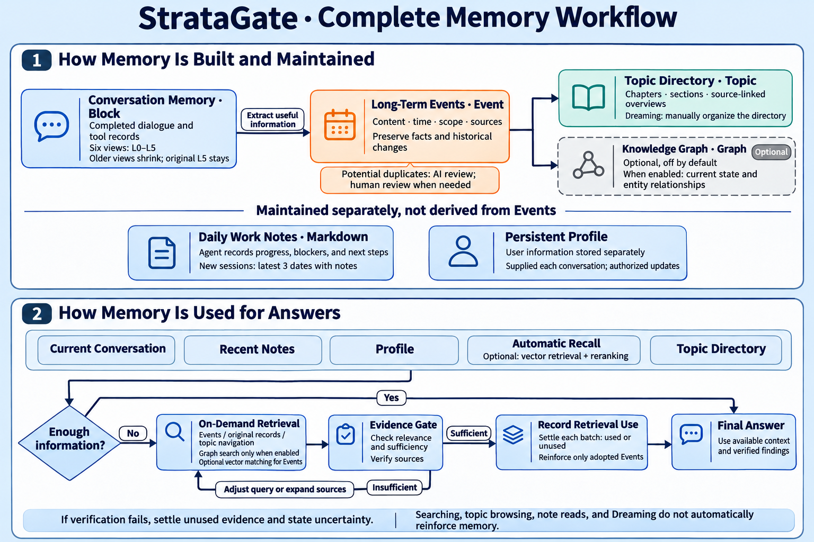
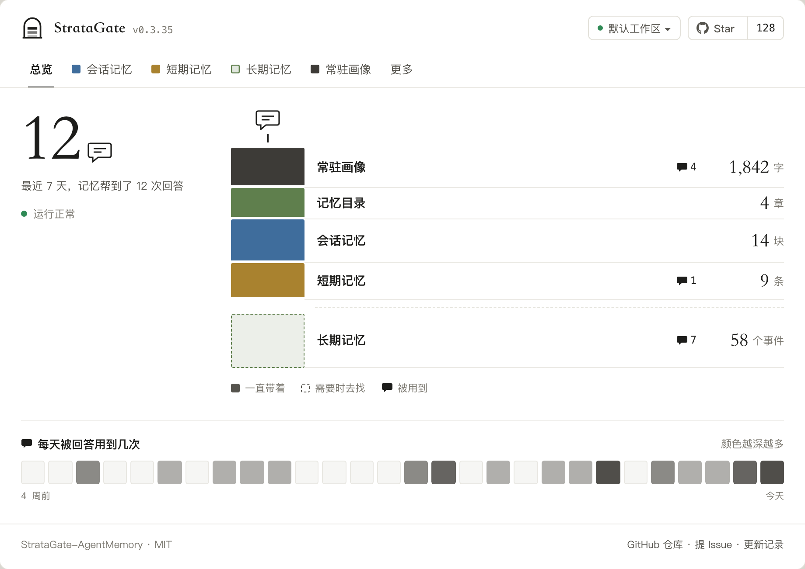
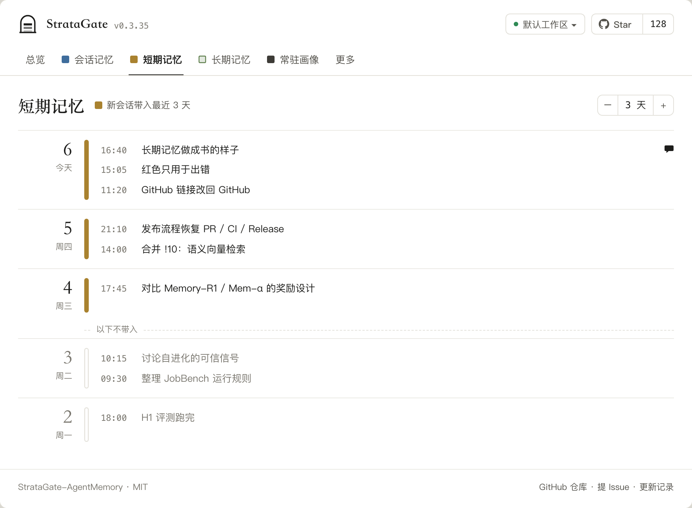
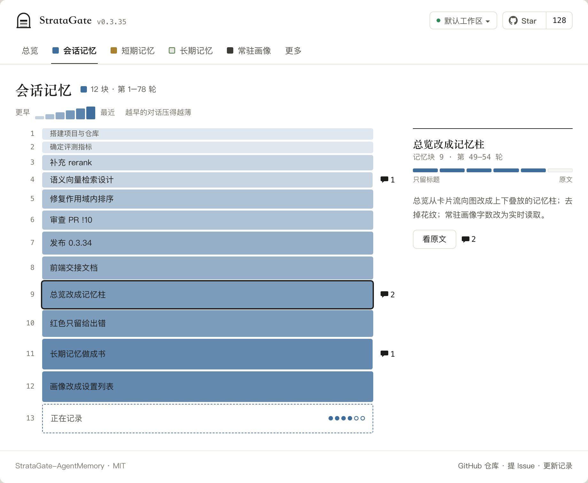
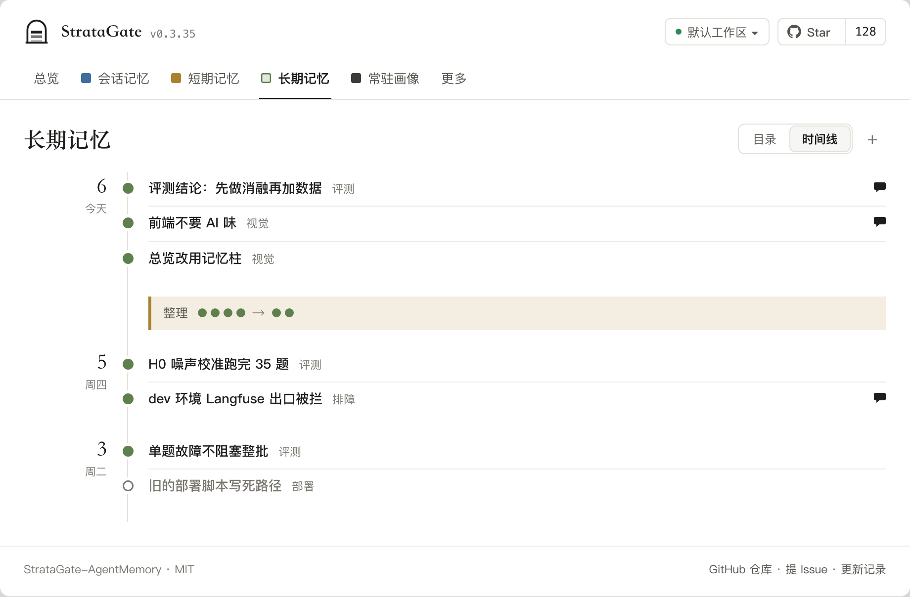
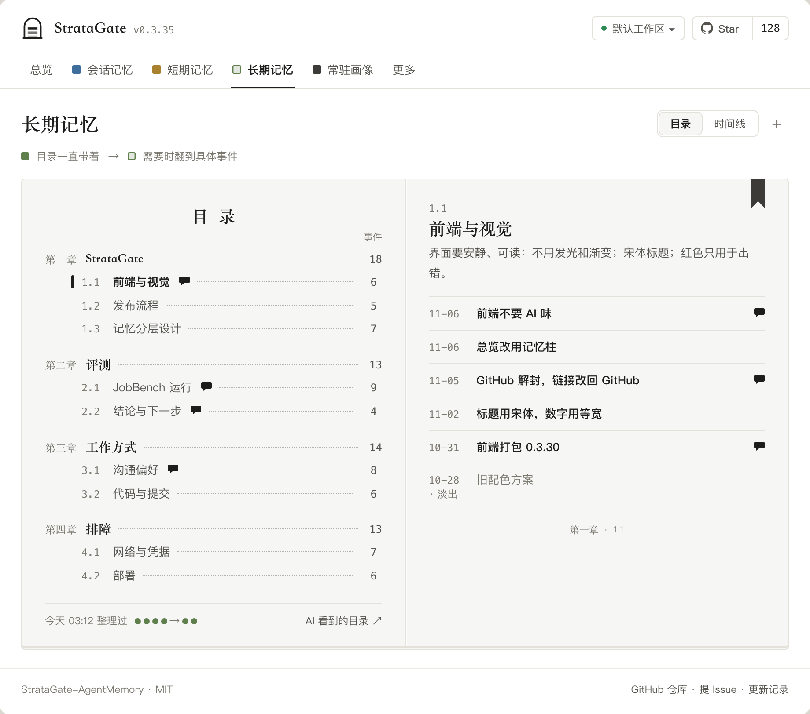
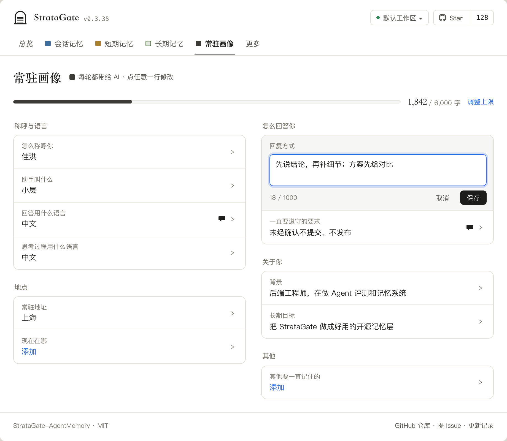
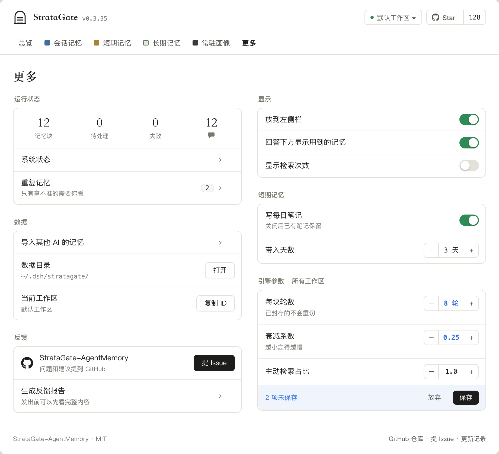

<div align="center">


# StrataGate

Project source, releases, and issues are available on [GitHub](https://github.com/diqierjia/StrataGate-AgentMemory). [Gitee](https://gitee.com/diqier4123/StrataGate-AgentMemory) remains a synchronized repository.

### Recent conversations stay detailed. Older memories grow more concise.

StrataGate is a cross-session memory plugin for DeepSeek Harness. Daily notes help resume recent work, layered conversation memory preserves historical detail that can be expanded, and long-term Events and the topic directory retain important information and help locate its sources. The knowledge graph, semantic vector retrieval, and reranking can be enabled as needed.

<p align="center">
  <a href="https://github.com/diqierjia/StrataGate-AgentMemory/actions/workflows/ci.yml"></a>
  <a href="https://www.npmjs.com/package/stratagate-dsh"></a>
  <a href="LICENSE"></a>
  <a href="https://github.com/diqierjia/StrataGate-AgentMemory/stargazers"></a>
</p>

[中文说明](README.zh-CN.md) · [DeepSeek Harness guide](docs/DSH.md) · [Memory details](docs/MEMORY_DETAILS.md) · [Architecture](docs/ARCHITECTURE.md) · [Full evaluation](docs/EVALUATION.md)

<strong>Published evaluation:</strong> on 152 questions from one LoCoMo conversation, `conv-26`, each answer received 10 independent evaluations. Mean judged accuracy was <strong>80.46%</strong>, versus <strong>63.22%</strong> for Mem0 base. These results use the R8 evaluation configuration. [See evaluation scope](#experimental-results).

</div>

---

<div align="center">

<h3 align="center">Community &amp; downloads</h3>

<table align="center">
  <tr>
    <td align="center">
      <a href="https://dshfind.com/en/plugins/diqierjia/StrataGate-AgentMemory?ref=badge">
        
      </a>
    </td>
    <td align="center">
      <strong>npm downloads</strong><br /><br />
      <a href="https://www.npmjs.com/package/stratagate-dsh"></a><br />
      <a href="https://www.npmjs.com/package/stratagate-dsh"></a>
    </td>
  </tr>
</table>

<p align="center">
  <a href="https://awesome-dsh-plugin.com"></a>
  <a href="CONTRIBUTING.md"></a>
</p>

</div>

---

## Why StrataGate?

1. **Daily notes carry work forward; historical conversations stay expandable.** Daily notes track progress, lessons from failures, blockers, and next steps, bringing the three most recent note dates into new sessions by default. Meanwhile, each conversation Block keeps six views (L0–L5): older dialogue progressively condenses in context while complete L5 source records remain preserved and expandable on demand. → [Daily notes](#daily-notes) · [Layered conversation memory](#layered-memory)

   

2. **Long-term memory retains lasting information and traces its sources.** Important decisions, preferences, requirements, and changes become source-linked Events, organized into a browsable Topic directory with Dreaming maintenance. An optional knowledge graph, semantic vector retrieval, reranking, and external AI memory import can be enabled as needed. → [Long-term memory](#event-cards) · [External memory import](#external-memory-import)

3. **Evidence gate: verify sufficiency before answering.** Daily notes and topic overviews help locate information, while historical facts are checked against source Events or original records. If retrieved evidence is insufficient, the agent searches further or states the uncertainty explicitly. → [Evidence gate](#evidence-gate)

4. **Retrieval hits do not automatically reinforce memory.** Search hits, automatic context injection, directory browsing, and daily-note reads do not trigger reinforcement. Only Events recorded as actually used in the final answer (or confirmed exact duplicates during active saving) increment adoption counts and slow future decay. → [Memory reinforcement](#use-only-reinforcement)

Get started: → [Quick start](#quick-start-deepseek-harness)

<a id="quick-start-deepseek-harness"></a>

## Quick start: DeepSeek Harness

Already using DeepSeek Harness? Copy this prompt to your agent:

```text
Follow https://github.com/diqierjia/StrataGate-AgentMemory/blob/main/docs/DSH.md to install StrataGate in my current DeepSeek Harness profile. Check version compatibility and verify that the plugin loads successfully. Let me know if a restart is required or you cannot identify the profile.
```

Or install manually (replace `web` with your profile name):

```bash
dsh plugin --profile web add stratagate-dsh
```

Restart the profile to begin automatically capturing conversations and organizing memories. View them under **DSH Settings → StrataGate-AgentMemory**. See the [plugin guide](docs/DSH.md) for configuration, supported versions, and troubleshooting.

<a id="how-stratagate-works"></a>

## How it works



StrataGate preserves conversation sources while organizing recent work and lasting information; when answering, the agent uses available context first and retrieves more detail only when needed:

1. **Preserve conversations across L0–L5.** Completed turns seal into memory Blocks; older Blocks show more concise views by default while complete L5 originals stay expandable.
2. **Track recent work in daily notes.** One Markdown file per day per space captures progress, blockers, and next steps, with the three most recent note dates loaded by default.
3. **Extract lasting Events and build lookup entry points.** Valuable facts, decisions, and changes become source-linked Events organized into the Topic directory (plus an optional knowledge graph).
4. **Answer from context, retrieve on demand.** Automatic recall supplies up to **4 Events** (and up to **4 graph nodes** when enabled) within ~**900 tokens**, plus a ~**400-token** topic directory; daily notes, persistent Profile, layered conversation memory, and unsealed turns are provided separately.
5. **Check evidence and record actual use.** Explicitly retrieved evidence goes through sufficiency assessment; only Events actually used in the final answer update memory weights.

## Core design

Each type of memory serves a distinct role:

| Component | What it stores | Main purpose |
| --- | --- | --- |
| **Daily notes** | Recent progress, results, blockers, and next steps | Resume work in a new session |
| **Conversation memory: Block** | Six views of the same conversation, from index to original records | Reduce default history while keeping detail recoverable |
| **Event memory: Event** | Useful lasting information with time, scope, and sources | Find facts, decisions, and historical changes |
| **Topic directory: Topic** | Chapters, sections, and source-linked overviews of related Events | Find specific memories from a vague recollection |
| **Knowledge graph: Graph (optional)** | Current state and entity relationships derived from Events | Query current information and connections |
| **Persistent Profile** | User information relevant to every conversation | Supply configured preferences such as language and form of address |

The agent maintains daily notes, Topics and the optional Graph are derived from Events, and Profile is stored separately. Both conversation simplification and Event weight decay follow conversation progress rather than elapsed calendar days.

<picture>
  <source media="(prefers-color-scheme: dark)" srcset="docs/assets/stratagate-ui-overview-dark.png" />
  
</picture>

*Plugin UI overview: always-loaded layers (Profile, Topic directory, Conversation memory, Short-term memory), on-demand Long-term Events, and the 4-week adoption heatmap.*

<a id="daily-notes"></a>

### 1. Short-term memory: resume work with daily notes

The agent writes daily Markdown notes per memory space to record progress, intermediate results, useful lessons from failures, blockers, and next steps. For example, a project note might look like:

```text
Project X: dependency migration

Completed: switched the project to pnpm.
Pending: verify whether CI passes after migration.
Next: run CI and check build and test results.
```

New sessions include notes from the **three most recent dates with notes** by default (configurable from 1–30), pinned as a session snapshot so later writes do not repeatedly churn context. Older notes remain searchable by date or keyword.

<picture>
  <source media="(prefers-color-scheme: dark)" srcset="docs/assets/stratagate-ui-daily-notes-dark.png" />
  
</picture>

Daily notes help resume work, not replace source verification—historical decisions or dates should still be checked against Events and original messages, and reading notes does not reinforce memory. See [daily-notes snapshot and toggle details](docs/MEMORY_DETAILS.md#daily-notes).

<a id="layered-memory"></a>

### 2. Conversation memory: condense older dialogue and recover detail when needed

The DeepSeek Harness plugin seals a memory Block every **6 complete turns** by default (configurable), keeping six views of the same conversation:

| Level | Contents | Primary use |
| --- | --- | --- |
| **L0** | Title and tags | Identify a piece of history |
| **L1** | Short summary | Understand the discussion's topic |
| **L2** | Key facts | Review decisions, constraints, plans, and outcomes |
| **L3** | Dialogue condensed by fixed rules | Remove standalone fillers and repeated long text; compact tool records |
| **L4** | Readable, near-verbatim dialogue | Preserve user and assistant wording; compact recognized tool records |
| **L5** | Source messages and tool records | Verify original wording, complete context, and tool results |

The model summarizes L0–L2 while deterministic rules generate L3/L4—**none of these views overwrites L5 source records**. As new ready Blocks accumulate, older Blocks decay to lighter views by default; the agent can expand sources when details are needed, and users can manually pick a display level that takes priority over automatic compression and resets that Block's decay anchor.



See [L3/L4 pruning rules, decay formula, default schedule, and manual selection](docs/MEMORY_DETAILS.md#conversation-memory) (and [Architecture](docs/ARCHITECTURE.md)).

<a id="event-cards"></a>

### 3. Long-term memory: retain important information and trace its sources

Long-term memory distills lasting information into Events, organizes them into a browsable Topic directory, optionally projects a knowledge graph, and stores always-on user preferences separately in the Persistent Profile.

#### 3.1 Event memory & updates

Important facts, decisions, preferences, requirements, and changes become Events with content, scope, source messages, and temporal fields—distinguishing **mention time** from **occurrence time** (for example, “Finish the prototype next week” said on May 6 records a planned time, not proof of completion). Routine file reads, tool calls, and task-local instructions are filtered out rather than turned into permanent Events.



New information is handled according to its relationship to existing memory:

| New information | How to interpret it |
| --- | --- |
| “The project switched from npm to pnpm” | Update the current choice while retaining the earlier decision and its sources |
| “Post-migration CI verification is pending” | Add an open question, not a claim that tests have passed |
| Two statements conflict and their validity is unresolved | Retain the conflict for further verification |
| Several records may describe the same event | Check their complete contents and sources before deciding whether to merge |

**Similarity does not establish duplication, and later progress does not make earlier records useless.** Potential duplicates are evaluated by AI with their sources; uncertain cases go to user review with edit, keep, and undo support. See [temporal fields, scope, and duplicate review details](docs/MEMORY_DETAILS.md#event-memory) and the [Event extraction guide (Chinese)](docs/event-extractor.md).

<a id="memory-topics"></a>

#### 3.2 Topic directory & Dreaming

When you only have a vague recollection of an earlier discussion, the Topic directory provides chapters, sections, and on-demand overviews linked directly back to source Events.

<picture>
  <source media="(prefers-color-scheme: dark)" srcset="docs/assets/stratagate-ui-topic-directory-dark.png" />
  
</picture>

**Dreaming reviews historical memory.** You can start it manually from the directory page (even with no unassigned Events), or let it start automatically when new material exists, the main agent has been idle for ~30 minutes, and at least 24 hours have passed since the last automatic run. Its dedicated agent inspects cross-session history, fixes missing or erroneous derived Events, consolidates duplicates, updates daily notes, and maintains the directory and reusable experiences (`memory_search_experiences`), while keeping original conversations, historically true facts, and Profile settings intact. Runs can be viewed, paused, resumed, or stopped without losing saved changes. See [Topic directory (Chinese)](docs/MEMORY_TOPICS.zh-CN.md) and [Dreaming maintenance (Chinese)](https://github.com/diqierjia/StrataGate-AgentMemory/blob/main/docs/dreaming-agent.md).

<a id="current-state-graph"></a>

#### 3.3 Knowledge graph (optional)

When enabled, the knowledge graph derives entities (people, projects, tools, organizations, places) and relationships from Events with source links, helping answer what is currently true and how entities connect. **The graph is off by default** because it adds model calls; Event cards, topics, ordinary retrieval, and Profile all work independently, and disabling the graph later preserves existing data. See [graph toggle and backfill details](docs/MEMORY_DETAILS.md#knowledge-graph) and [optional knowledge graph (Chinese)](https://github.com/diqierjia/StrataGate-AgentMemory/blob/main/docs/knowledge-graph.md).

<a id="persistent-profile"></a>

#### 3.4 Persistent Profile

The persistent Profile stores user information needed in every conversation, separated from relevance-retrieved Events and single-turn requests:

| User statement | Where it belongs | When it is used |
| --- | --- | --- |
| “Use Chinese by default from now on” | Persistent Profile | Automatically supplied across sessions after being set |
| “This project has switched to pnpm” | Event memory | Recalled or retrieved for relevant questions |
| “Keep this answer brief” | Current conversation | Applies to this answer |

Explicit user requests apply directly, whereas inferred Profile updates require stating the proposed field and value for user consent.



See [Profile routing rules](docs/MEMORY_DETAILS.md#persistent-profile) and the [plugin guide](docs/DSH.md).

<a id="evidence-gate"></a>

### 4. Retrieval and the evidence gate

When available context is not enough, the agent searches Events, original conversations, or the Topic directory (and graph entities when enabled). Retrieval can be enhanced as needed:

| Method | Purpose |
| --- | --- |
| Default retrieval | Find relevant records using keywords and related signals |
| Vector retrieval (optional) | Add semantically similar Events even when their wording differs |
| Reranking (optional) | Reorder automatic-recall candidates so more relevant memories enter context first |

Vector retrieval and reranking are configured separately (reranking falls back to original order on timeout or error). An empty search result may reflect scope or keyword choices—the agent adjusts its search rather than concluding something was never recorded.

Before answering from explicit retrieval, the **evidence gate** checks whether retrieved items actually support the question. For example, for *“Why did we originally switch to pnpm?”*:

| Step | Information found | Next action |
| --- | --- | --- |
| Locate the topic | An overview of “Project technology choices” mentions a package-manager change | Follow the sources to specific Events |
| Retrieve the Event | “The project switched from npm to pnpm” | The change is established but its reason is missing; expand the source |
| Check the original text | Example: “Installation is faster, and it better fits our multi-package structure” | Verify the project and time, then explain the reason from the source |

The model assesses sufficiency while code enforces valid batch references and usage recording. If sources still cannot confirm an answer, the agent states the uncertainty rather than guessing. See [evidence assessment fields and protocol checks](docs/MEMORY_DETAILS.md#evidence-gate).

<a id="use-only-reinforcement"></a>

### 5. Memory reinforcement: retrieval does not reinforce; recorded adoption updates weights

Event weight guides recall priority and gradually decays over conversation turns when unused, without deleting historical records. Search hits, automatic context injection, directory browsing, overview expansion, and daily-note reads **never trigger reinforcement**.


Only Events recorded as **actually used in the final answer** (and exact-duplicate confirmations during active memory saving) increment the adoption count and reset the decay anchor, slowing future decay. Different memory categories retain different minimum weights:

| Memory category | Default minimum weight |
| --- | ---: |
| Routine information | 0 |
| User preference | 0.3 |
| Identity information | 0.9 |
| Safety information | 1.0 |

Pinned memories have an effective weight of 1, while superseded Events receive a low cap. These weights manage recall priority, not factual accuracy. See [long-term weight formula (`λ_event = 0.015`) and duplicate-merge rules](docs/MEMORY_DETAILS.md#weight-formula).

<a id="model-configuration"></a>
<a id="external-memory-import"></a>

## Model configuration, import, and upgrades

**Chat and memory processing can use different models**, and vector retrieval and reranking are configured independently:

| Model purpose | What it handles | How to select it |
| --- | --- | --- |
| Chat model | Conversations and answers | Select in DSH |
| Memory-processing model | Conversation compression, Event extraction, topic organization, and Dreaming | Follow the chat model or specify a separate DSH model |
| Embedding model (optional) | Find semantically related Events | Configure API URL, key, and model separately |
| Reranking model (optional) | Reorder automatic-recall candidates | Configure separately; usable independently of vector retrieval |



- **Import memory from another AI:** Paste a memory summary exported from another AI in the DSH UI to preview additions, merges, supersessions, and conflicts, adjust low-confidence items manually, or undo a committed batch while keeping original imported text. → [External-memory import guide (Chinese)](docs/EXTERNAL_MEMORY_IMPORT.zh-CN.md)
- **Compatibility & local data:** Restart the corresponding DSH profile after upgrading. The current version covers DSH **0.2.x** (including prereleases) and retains older supported hosts; DSH **0.3.x** is not yet supported. Conversation sources and long-term memories live in local SQLite, daily notes in Markdown, and uninstalling does not delete your data. → [Configuration details](docs/MEMORY_DETAILS.md#configuration-and-import) · [DSH guide](docs/DSH.md)

<a id="experimental-results"></a>

## Evaluation results and limits

The published R8 comparison uses LoCoMo conversation `conv-26` (**419 messages, 35 sessions, 152 questions**, categories 1–4). Each system rebuilt its memory and generated answers; each answer received **10 independent Judge evaluations** (repeated judgments, not ten full system runs):

| Metric | StrataGate | Mem0 base | Difference |
| --- | ---: | ---: | ---: |
| Mean accuracy across 10 Judge runs | **80.46%** | 63.22% | **+17.24 percentage points** |
| Majority-correct | **121 / 152 (79.61%)** | 96 / 152 (63.16%) | **+25 questions** |
| Temporal | **74.86%** | 34.59% | **+40.27 percentage points** |
| Single-hop | **89.29%** | 75.14% | **+14.14 percentage points** |
| Multi-hop | **66.56%** | 61.56% | +5.00 percentage points |
| Open-domain | 83.08% | **84.62%** | -1.54 percentage points |

Both systems shared the same questions, answer model, Judge model, prompt, and parser, while differing in extraction, retrieval, embeddings, and context—so this compares two complete system configurations. Results cover only `conv-26` and do not isolate individual components (ablation experiments are still needed).

Of the **31 majority-incorrect questions**, 15 were direct answers without retrieval, 14 were judged sufficient on incomplete or neighboring evidence, and 2 hit the retrieval budget. See the [failure breakdown](docs/MEMORY_DETAILS.md#evaluation-failure-analysis), [full evaluation](docs/EVALUATION.md), and [machine-readable results](benchmarks/locomo-conv26-r8-final.json).

<a id="code-entry-points"></a>

## Development and documentation

This section is for developers (DSH users can follow [Quick start](#quick-start-deepseek-harness) without building the repository). Requires Node.js `^22.19.0 || >=24.0.0`:

```bash
npm install
npm run check
npm test
npm run build
```

| Resource | Contents |
| --- | --- |
| [DeepSeek Harness guide](docs/DSH.md) | Installation, configuration, UI, memory tools, and recovery |
| [Memory details, rules & formulas](docs/MEMORY_DETAILS.md) | L3/L4 pruning, decay & weight formulas, update rules, evidence gate schema, and R8 failure breakdown |
| [Memory directory and topic overviews (Chinese)](docs/MEMORY_TOPICS.zh-CN.md) | Chapters and sections, source tracing, background organization, budgets, and recovery |
| [Event extraction rules (Chinese)](docs/event-extractor.md) | Extraction decisions, scope, duplicates and historical relationships, and compatibility |
| [Dreaming memory maintenance (Chinese)](https://github.com/diqierjia/StrataGate-AgentMemory/blob/main/docs/dreaming-agent.md) | Scope, triggers, deletion, and recovery |
| [Optional knowledge graph (Chinese)](https://github.com/diqierjia/StrataGate-AgentMemory/blob/main/docs/knowledge-graph.md) | Defaults, enabling, pausing, disabling, and historical backfill |
| [Manual level selection (Chinese)](https://github.com/diqierjia/StrataGate-AgentMemory/blob/main/docs/user-operation-priority.md) | Content preview, application, insufficient capacity, and recovery |
| [Architecture](docs/ARCHITECTURE.md) | Layering, Events and graph, retrieval, evidence gate, weights, storage, and core APIs |
| [External-memory import](docs/EXTERNAL_MEMORY_IMPORT.zh-CN.md) | Export format, import flow, and integration example |
| [Full evaluation](docs/EVALUATION.md) | Protocol, version history, failure analysis, and result scope |
| [Evaluation summary data](benchmarks/locomo-conv26-r8-final.json) | Published results, statistics, and artifact information |
| [Core-engine example](packages/core/examples/basic.ts) | Minimal API integration example |

The core engine is in `packages/core/` (see [blocks.ts](packages/core/src/blocks.ts) and [weights.ts](packages/core/src/weights.ts)); the DSH adapter is in `src/`.

## Contributing

Contributions are welcome—bug fixes, documentation improvements, integrations, or better memory and retrieval strategies. Read [`CONTRIBUTING.md`](CONTRIBUTING.md) to get started, or [open an issue](https://github.com/diqierjia/StrataGate-AgentMemory/issues) before making large changes.

## Contributors

<a href="https://github.com/diqierjia/StrataGate-AgentMemory/graphs/contributors">
  
</a>

## License

StrataGate is available under the [MIT License](LICENSE).
