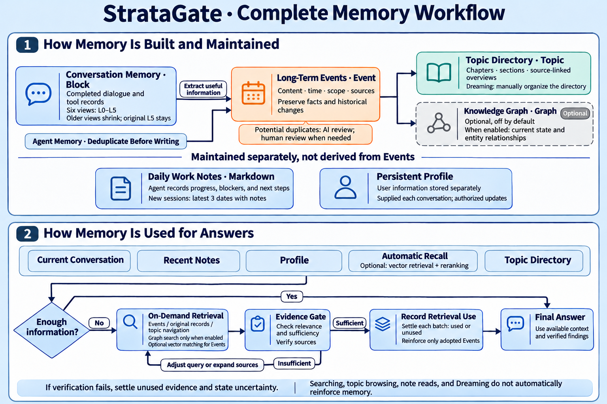
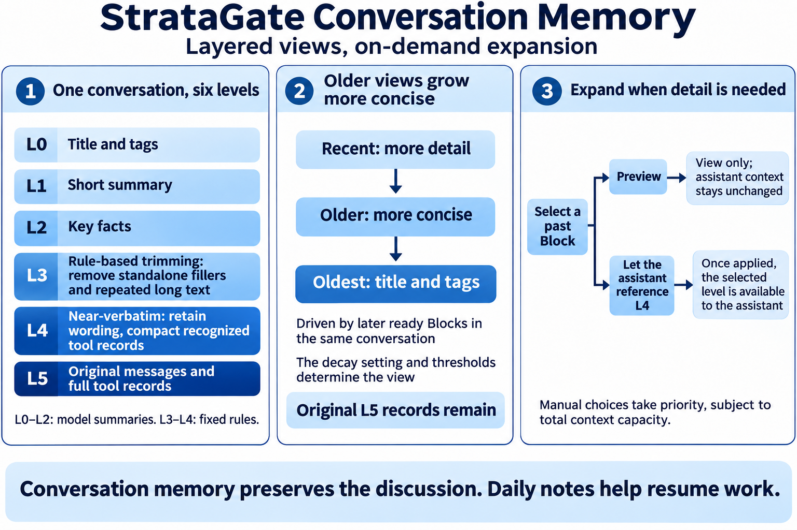
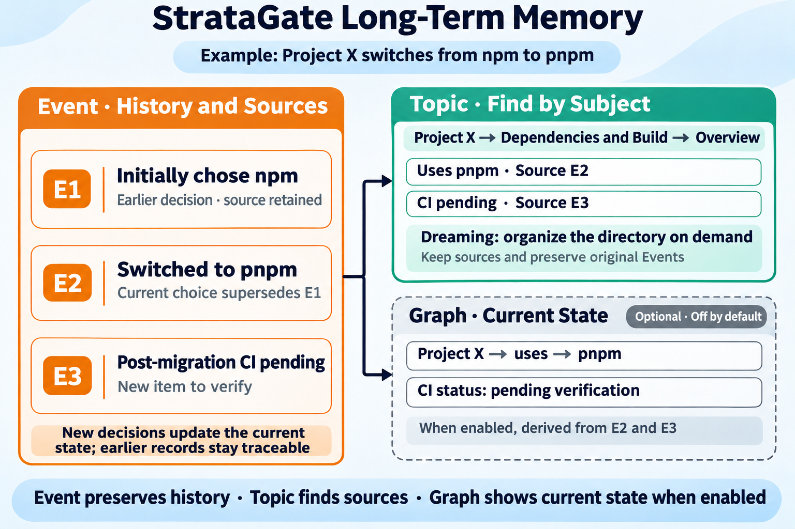

<div align="center">


# StrataGate

Project source, releases, and issues are available on [GitHub](https://github.com/diqierjia/StrataGate-AgentMemory). [Gitee](https://gitee.com/diqier4123/StrataGate-AgentMemory) remains a synchronized repository.

### Recent conversations stay detailed. Older memories grow more concise.

StrataGate is a cross-session memory plugin for DeepSeek Harness. Daily notes help resume recent work, layered conversation memory preserves historical detail that can be expanded, and long-term Events and the topic directory retain important information and help locate its sources. The knowledge graph, semantic vector retrieval, and reranking can be enabled as needed.

<p align="center">
  <a href="https://github.com/diqierjia/StrataGate-AgentMemory/actions/workflows/ci.yml"></a>
  <a href="https://www.npmjs.com/package/stratagate-dsh"></a>
  <a href="LICENSE"></a>
  <a href="https://github.com/diqierjia/StrataGate-AgentMemory/stargazers"></a>
</p>

[中文说明](README.zh-CN.md) · [DeepSeek Harness guide](docs/DSH.md) · [Architecture](docs/ARCHITECTURE.md) · [Full evaluation](docs/EVALUATION.md)

<strong>Published evaluation:</strong> on 152 questions from one LoCoMo conversation, `conv-26`, each answer received 10 independent evaluations. Mean judged accuracy was <strong>80.46%</strong>, versus <strong>63.22%</strong> for Mem0 base. These results use the R8 evaluation configuration. [See evaluation scope](#experimental-results).

</div>

---

<div align="center">

<h3 align="center">Community &amp; downloads</h3>

<table align="center">
  <tr>
    <td align="center">
      <a href="https://dshfind.com/en/plugins/diqierjia/StrataGate-AgentMemory?ref=badge">
        
      </a>
    </td>
    <td align="center">
      <strong>npm downloads</strong><br /><br />
      <a href="https://www.npmjs.com/package/stratagate-dsh"></a><br />
      <a href="https://www.npmjs.com/package/stratagate-dsh"></a>
    </td>
  </tr>
</table>

<p align="center">
  <a href="https://awesome-dsh-plugin.com"></a>
  <a href="CONTRIBUTING.md"></a>
</p>

</div>

---

## Why StrataGate?

1. **Daily notes carry work forward; historical conversations can be expanded.**

   (1) **Daily notes help resume work.** The agent records progress, intermediate results, useful lessons from failures, blockers, and next steps by date. New sessions include notes from the three most recent dates with notes by default, reducing the need to repeat background information. → [Daily notes](#daily-notes)

   (2) **Conversation memory keeps recent detail and makes older history concise.** Each conversation block has six views, L0–L5, with different levels of detail. As more conversation accumulates, older dialogue gradually becomes key facts, short summaries, and title indexes, reducing the context occupied by history. → [Layered conversation memory](#layered-memory)

   (3) **Views shrink while original records remain.** Complete L5 source messages and tool records are preserved. When details need checking, the agent can expand a memory to recover the original wording and context. → [Layered conversation memory](#layered-memory)

   

2. **Long-term memory retains important information and helps trace sources and changes.**

   (1) **Events record what happened.** Important decisions, preferences, requirements, and changes become Events with scope, time, and source references. AI evaluates potential duplicates; uncertain cases can be reviewed by the user, and the processing history remains traceable. → [Event memory](#event-cards)

   (2) **The topic directory shows what has been remembered.** Related Events form chapters, sections, and source-linked overviews. The agent can browse topics before retrieving specific Events. Users can also start Dreaming, a dedicated agent that reviews and organizes the existing directory. → [Topic directory](#memory-topics)

   (3) **The optional knowledge graph organizes current state.** When enabled, it derives current information and relationships about people, projects, tools, and other entities from Events, retaining their sources. The graph is off by default; Event cards, topics, and ordinary retrieval work independently. → [Current-state graph](#current-state-graph)

   (4) **Retrieval can be enhanced as needed.** Default retrieval uses keyword-based and related mechanisms. Configuring an embedding model adds semantically similar Events; a separately configured reranking model can refine the order of automatic recall results.

   (5) **Bring memories from other AIs.** Imported content can become traceable long-term Events while the original imported text remains preserved. → [External memory import](#external-memory-import)

3. **Evidence gate: check whether retrieved evidence is sufficient before answering.**

   Daily notes help resume work, while topic overviews help locate information. Historical facts still need checking against source Events or original records. A relevant search result may be insufficient to answer the question. The agent assesses the evidence and searches again or expands sources when needed. If it still cannot confirm the answer, it states the uncertainty. → [Evidence gate](#evidence-gate)

4. **Retrieval hits do not automatically reinforce memory.**

   Search hits, automatic context injection, and topic browsing do not trigger reinforcement. In the retrieval-use workflow, only Events recorded as actually used in the final answer increase the adoption count and reset the decay anchor. More adoptions mean slower future decay. Explicit memory recording can also reinforce an existing record when the information is confirmed as an exact duplicate of a currently valid fact. → [Weights and adoption-based reinforcement](#use-only-reinforcement)

Get started: → [Quick start](#quick-start-deepseek-harness)

<a id="quick-start-deepseek-harness"></a>

## Quick start: DeepSeek Harness

Already using DeepSeek Harness? Copy this prompt to your agent:

```text
Follow https://github.com/diqierjia/StrataGate-AgentMemory/blob/main/docs/DSH.md to install StrataGate in my current DeepSeek Harness profile. Check version compatibility and verify that the plugin loads successfully. Let me know if a restart is required or you cannot identify the profile.
```

Or install manually (replace `web` with your profile name):

```bash
dsh plugin --profile web add stratagate-dsh
```

Restart the profile to begin automatically capturing conversations and organizing memories. View them under **DSH Settings → StrataGate-AgentMemory**.

See the [plugin guide](docs/DSH.md) for configuration, supported versions, and troubleshooting.

<a id="how-stratagate-works"></a>

## How it works



StrataGate preserves conversation sources while organizing recent work and lasting information. When answering, the agent uses the available context first and retrieves more detail when needed.

1. **Save conversations and preserve the originals.** Completed turns form memory Blocks, each stored as six views, L0–L5, with different levels of detail. Older Blocks display more concise views by default and can be expanded when needed; complete original records remain preserved.
2. **Maintain daily notes to resume recent work.** The agent records progress, intermediate results, useful lessons from failures, blockers, and next steps as needed, with one Markdown file per day in each memory space. New sessions include notes from the three most recent dates with notes by default, helping continue earlier work.
3. **Organize lasting information and provide ways to find it.** Facts, decisions, preferences, and requirements with future value become Events with time, scope, and source references. The topic directory organizes related Events into chapters, sections, and overviews. When the knowledge graph is enabled, it also derives current state and relationships from Events.
4. **Use available context and retrieve detail as needed.** The plugin supplies the current conversation, any configured persistent Profile, recent notes, a small set of relevant memories, and a concise topic directory. If that information is sufficient, the agent answers directly. Otherwise, it searches Events or original records, or browses topics and follows their sources. With the graph enabled, it can also search entities and relationships.
5. **Check evidence and record actual use.** The agent assesses whether explicitly retrieved evidence is sufficient, searches further if needed, and answers using sufficient evidence. It records the Events actually used to update memory weights. Searching, browsing the directory, or reading daily notes does not by itself trigger reinforcement.

Automatic recall includes at most **4 Events** and, when the graph is enabled, up to **4 graph nodes**, sharing a budget of approximately **900 tokens**. The topic directory has a separate budget of approximately **400 tokens**. Daily notes, the persistent Profile, layered conversation memory, and unsealed turns are supplied separately.

## Core design

Each type of memory serves a different purpose:

| Component | What it stores | Main purpose |
| --- | --- | --- |
| **Daily notes** | Recent progress, results, blockers, and next steps | Resume work in a new session |
| **Conversation memory: Block** | Six views of the same conversation, from index to original records | Reduce default history while keeping detail recoverable |
| **Event memory: Event** | Useful lasting information with time, scope, and sources | Find facts, decisions, and historical changes |
| **Topic directory: Topic** | Chapters, sections, and source-linked overviews of related Events | Find specific memories from a vague recollection |
| **Knowledge graph: Graph (optional)** | Current state and entity relationships derived from Events | Query current information and connections |
| **Persistent Profile** | User information relevant to every conversation | Supply configured preferences such as language and form of address |

The agent maintains daily notes, the graph and topics are derived from Events, and the Profile is stored separately. Conversation simplification and Event weight decay follow conversation progress rather than elapsed calendar days.

<a id="daily-notes"></a>

### 1. Short-term memory: resume work with daily notes

The agent writes daily notes as needed to record progress, intermediate results, useful lessons from failures, blockers, and next steps. Each memory space stores one Markdown file per day, helping new sessions understand where work stopped and what comes next.

For example, a project note might contain:

```text
Project X: dependency migration

Completed: switched the project to pnpm.
Pending: verify whether CI passes after migration.
Next: run CI and check build and test results.
```

**New sessions reference recent notes by default.** Notes from the three most recent dates with notes are included by default; this number can be set to 1–30. Older notes remain searchable by date or keyword. Each session fixes a note snapshot when first loaded. Later writes do not repeatedly change that context, and the latest content can be read again when needed.

**Notes help resume work; historical facts remain verifiable.** The agent maintains the notes, which are not complete conversation records. To verify a decision, date, or reason, retrieve Events and original messages. Reading notes does not reinforce memory.

View notes under **DSH Settings → StrataGate-AgentMemory → Short-term memory**. Disabling daily notes stops writes and automatic inclusion while preserving existing files.

<a id="layered-memory"></a>

### 2. Conversation memory: condense older dialogue and recover detail when needed

Daily notes summarize recent work, while conversation memory preserves the original discussion. StrataGate stores several levels of detail for the same conversation and gradually reduces the history included by default as more conversation accumulates.



**One conversation block, six levels of detail.**

The DeepSeek Harness plugin seals a memory Block every **6 complete turns** by default. A turn consists of a user question and the assistant's complete response. The Block size is configurable; content below the boundary remains in the current conversation.

| Level | Contents | Primary use |
| --- | --- | --- |
| **L0** | Title and tags | Identify a piece of history |
| **L1** | Short summary | Understand the discussion's topic |
| **L2** | Key facts | Review decisions, constraints, plans, and outcomes |
| **L3** | Dialogue condensed by fixed rules | Remove standalone fillers and repeated long text; compact tool records |
| **L4** | Readable, near-verbatim dialogue | Preserve user and assistant wording; compact recognized tool records |
| **L5** | Source messages and tool records | Verify original wording, complete context, and tool results |

The model summarizes L0–L2; fixed rules generate L3/L4. L3 removes further redundancy, while L4 stays close to the original wording. **None of these views overwrites the L5 source records.**

<details>
<summary>Exact pruning rules, decay formula, and level thresholds</summary>

The model produces L0–L2 summaries. L3 and L4 do not use model paraphrasing; code generates them with these fixed rules:

- **L4:** Remove system messages. User and assistant text is preserved except for trimming outer whitespace and adding `User`, `Assistant`, or other role labels. Recognized structured tool records retain the tool name and a result summary of at most 160 characters while omitting raw `arguments`, `params`, `input`, and `request` fields. Tool-role text that is not recognized as tool JSON remains unchanged.
- **L3:** Condense further without semantic rewriting. A sentence is removed only when, after trailing punctuation is stripped, it exactly matches a fixed filler allowlist such as `ok`, `thanks`, `got it`, `好的`, `明白`, `收到`, `谢谢`, or `可以`. After whitespace normalization and case folding, code-like paragraphs and paragraphs of at least 80 characters are deduplicated: the first copy remains verbatim, and later exact duplicates become an omission marker. Tool records use the same name-and-result-summary form as L4.
- **Length guard:** If generated L4 would be longer than L5, L5 is used instead. If L3 would be longer than L4, L4 is used instead, preserving `L3 ≤ L4 ≤ L5`.

Source records are saved first, followed by summarization and Event processing. Only a fully processed, ready Block can replace its corresponding native history and participate in decay.

Display changes follow exponential decay:

<p align="center"><strong>w<sub>block</sub>(age) = e<sup>−λ<sub>block</sub> · age</sup></strong></p>

The default decay coefficient λ<sub>block</sub> is **0.30**. Code maps weight ranges to display levels. Smaller coefficients preserve detail for longer and therefore consume more context.

In this formula, `age` is the distance between the current display anchor and the latest ready Block in the same conversation. It measures conversation progress, **not elapsed calendar days**. Unsealed turns and Blocks still awaiting model processing do not advance this decay.

For a Block that starts at L5 and is never expanded again, the default schedule is:

| Additional ready Blocks | Default display level |
| ---: | --- |
| 0–1 | L5 |
| 2 | L4 |
| 3–4 | L3 |
| 5–6 | L2 |
| 7–8 | L1 |
| 9 or more | L0 |

The figure illustrates the trend. Actual changes depend on both the decay coefficient and level thresholds; a new Block does not necessarily cause a one-level drop.

</details>

**As more conversation accumulates, older Blocks default to less detail.**

Conversation memory becomes concise according to the number of subsequent ready Blocks, not elapsed calendar days. The decay setting controls how long detailed views remain and can be adjusted in settings.

**The agent can expand sources, and users can choose a level manually.**

For example, an older conversation currently shows only “Discussed the project's technical approach.” If the user asks why pnpm was originally chosen, the agent can read more detailed dialogue or the original records to find the reason.

The layered-content preview is for viewing only. Choosing an action such as “Let the assistant reference L4” attempts to apply that content to the conversation. The interface distinguishes an applied choice, a pending choice, and one that cannot be applied.

A user's manually chosen level takes priority over automatic compression and the agent's evidence reads. If context capacity is insufficient, the system first tries to condense other automatically managed history while preserving other manual choices; if that is still insufficient, it explains why. A manual choice resets the decay anchor, and the view can gradually become concise again as subsequent conversation accumulates.

<a id="event-cards"></a>

### 3. Long-term memory: retain important information and trace its sources and changes

Long-term memory organizes information with future value into Events and provides a topic directory to help find it. The optional knowledge graph organizes current state and relationships. The persistent Profile is stored separately and supplies configured user information in each conversation.



The figure uses sample data. Its graph view illustrates the functionality when enabled.

#### 3.1 Event memory: retain information with future value

Important facts, decisions, preferences, requirements, and changes can be saved as Events. Each Event retains its content, scope, source messages, and any temporal information that can be established. A Block can produce multiple Events or contain nothing that needs extraction.

| Time | Meaning |
| --- | --- |
| Mention time | When the conversation referred to the event |
| Occurrence time | When the event happened or is planned to happen |

If a user says “Finish the prototype next week” on May 6, May 6 is the mention date, while “next week” describes the planned completion time. This record cannot serve as evidence that the prototype is complete. Uncertain dates retain their original wording and uncertainty.

**Retain useful information rather than recording every execution step.** Explicit requirements, corrections, changed decisions, confirmed causes, platform limitations, failure conditions, and meaningful outcomes may be worth retaining. Routine file reads, tool calls, and repeated tests do not each become Events merely because they occurred.

Records also need an appropriate scope. For example, “Align the arrows in this image” belongs to the current task and must not automatically become a permanent aesthetic preference. The agent can also use the active-memory tool to save information worth recalling later, without waiting for a Block to seal.

See the [Event extraction guide (Chinese)](docs/event-extractor.md) for detailed rules.

#### 3.2 Memory updates: distinguish additions, changes, conflicts, and duplicates

New information can lead to different updates:

| New information | How to interpret it |
| --- | --- |
| “The project switched from npm to pnpm” | Update the current choice while retaining the earlier decision and its sources |
| “Post-migration CI verification is pending” | Add an open question, not a claim that tests have passed |
| Two statements conflict and their validity is unresolved | Retain the conflict for further verification |
| Several records may describe the same event | Check their complete contents and sources before deciding whether to merge |

**Similarity does not establish duplication, and later progress does not make earlier records useless.** After code discovers potential duplicates, AI evaluates both records and their sources. Clearly distinct facts can remain separate; uncertain or unfinished cases are presented for user review.

Users can inspect both sources, edit a merged draft, keep either record, or keep both. Processing history and an undo entry point help trace changes before and after organization.

<a id="current-state-graph"></a>

#### 3.3 Knowledge graph: explore current state and relationships when needed

The knowledge graph derives people, projects, organizations, tools, places, and relationships such as “uses,” “participates in,” and “depends on” from Events. Node attributes and relationships retain their sources, helping answer what is currently true and how entities connect.

In the example, “the project uses pnpm” represents the current choice, while “CI verification pending” represents an unconfirmed result. The state changes only when new source evidence confirms it.

**The graph is off by default; other memory features remain available.** Enabling it adds model calls to organize entities and relationships. Use **More → Advanced settings → Memory configuration → Enable knowledge graph**. If historical Events need backfilling, the interface shows the amount of work for confirmation before starting.

Disabling the graph stops its processing, queries, and automatic recall while preserving existing graph data and sources. Event cards, topics, ordinary retrieval, and the persistent Profile work independently.

<a id="memory-topics"></a>

#### 3.4 Topic directory: find specific memories from a vague recollection

With clear keywords, search directly. With only a vague recollection of an earlier discussion, browse the topic directory first.

A Topic represents a lasting subject such as “Project X,” with sections for related matters such as “Dependencies and build.” On-demand overviews organize background, progress, decisions, changes, and open questions, with links to source Events.

For “Where did we leave the project's technical plan?”, the agent can find the topic, read its overview, then retrieve specific Events to verify agreed choices and outstanding decisions.

**Dreaming helps organize an existing directory.** Users can start a dedicated agent from the directory page to review existing Events and overviews and adjust chapters, sections, Event membership, and overview content. Its progress can be viewed, paused, resumed, or terminated; saved changes remain preserved.

Dreaming organizes the directory and overviews without rewriting original Event facts or reinforcing memory through organization or reading. **The directory helps locate information; specific facts still need checking against their sources.**

<a id="persistent-profile"></a>

#### 3.5 Persistent Profile: user information needed in every conversation

The persistent Profile stores user information that should remain available, separately from Events retrieved by relevance and requests that apply only to the current answer:

| User statement | Where it belongs | When it is used |
| --- | --- | --- |
| “Use Chinese by default from now on” | Persistent Profile | Automatically supplied across sessions after being set |
| “This project has switched to pnpm” | Event memory | Recalled or retrieved for relevant questions |
| “Keep this answer brief” | Current conversation | Applies to this answer |

The word “remember” alone does not determine where information belongs. Explicit user requests to change the Profile can be applied directly. Inferred Profile changes require the agent to state the proposed field and value and obtain user consent.

See the [plugin guide](docs/DSH.md) for Profile fields, location selection, and settings.

<a id="evidence-gate"></a>

### 4. Retrieval and the evidence gate: find relevant information, then check whether it answers the question

When the available context is sufficient, the agent can answer directly. When historical information is needed, it searches Events or original conversations, or browses the topic directory first. With the knowledge graph enabled, it can also search entities and relationships.

**Retrieval can be enhanced as needed.**

| Method | Purpose |
| --- | --- |
| Default retrieval | Find relevant records using keywords and related signals |
| Vector retrieval (optional) | Add semantically similar Events even when their wording differs |
| Reranking (optional) | Reorder automatic-recall candidates so more relevant memories enter context first |

Vector retrieval and reranking are configured separately and remain off when unconfigured. Reranking applies only to automatic recall and falls back to the original order on timeout or error. **A high rank, semantic similarity, or high memory weight does not establish factual accuracy or sufficient evidence for the current question.**

**An empty result does not prove that something was never recorded.**

Empty results may reflect the selected memory scope, keywords, or filters. The agent should adjust its search to the question rather than conclude “you never said that” from a single empty result. Retrieval errors should also be reported as such.

**The evidence gate checks whether the information answers the question.**

For “Why did we originally switch to pnpm?”:

| Step | Information found | Next action |
| --- | --- | --- |
| Locate the topic | An overview of “Project technology choices” mentions a package-manager change | Follow the sources to specific Events |
| Retrieve the Event | “The project switched from npm to pnpm” | The change is established but its reason is missing; expand the source |
| Check the original text | Example: “Installation is faster, and it better fits our multi-package structure” | Verify the project and time, then explain the reason from the source |

The quote is an illustrative example. If the sources do not explain the reason, the agent should state that it cannot confirm it rather than infer the historical decision from pnpm's general advantages.

The model assesses sufficiency; code checks source references and the retrieval protocol. Explicit retrieval results must complete assessment and usage recording, including closing out results that were not used. Insufficient evidence calls for further retrieval; uncertainty should remain explicit when verification is unavailable.

<details>
<summary>Evidence assessment fields and protocol checks</summary>

| Field | What it explains |
| --- | --- |
| `verdict` | Whether evidence is sufficient, partial, or mismatched |
| `evidence_refs` | Which retrieved items support the assessment |
| `fit` | How the evidence matches the question |
| `missing` | What information is still missing |
| `next_strategy` | Whether to answer, search again, or expand a memory |

References must belong to the selected retrieval batch. Accepting `sufficient` requires valid evidence references and an explicit choice to answer. Usage records contain only evidence actually used in the answer, or an empty list when none was used. See the [plugin guide](docs/DSH.md) for interfaces.

</details>

<a id="use-only-reinforcement"></a>

### 5. Memory reinforcement: retrieval does not reinforce; recorded adoption updates weights

An Event's weight participates in later recall and ranking. Without adoption, it gradually decreases as conversation turns accumulate, while the Event and its sources remain preserved. This differs from a conversation Block changing its L0–L5 display level.


**Retrieval or display alone does not trigger reinforcement.**

Search hits, automatic context inclusion, directory browsing, overview expansion, and daily-note reads do not increase adoption counts or reset decay anchors merely because content appears.

**Events actually used in the answer receive that adoption's reinforcement.**

After choosing evidence for the final answer, the agent records its use. Code checks the retrieval batch and assessment result, then increases the corresponding Events' adoption counts and updates their decay anchors while preventing the same operation from being applied twice. Unused results receive no reinforcement from that operation.

More adoptions mean slower future decay, allowing memories that repeatedly help answer questions to retain higher recall priority.

**Confirmed duplicates during active-memory recording can also reinforce existing facts.**

When the active-memory tool saves information, a currently valid fact whose normalized full text matches exactly can directly reinforce an existing record. Other similar content requires further judgment to add, merge, supersede, flag a conflict, or ignore; textual similarity alone does not directly trigger reinforcement.

Duplicate-card organization also differs from answer adoption: a merge can preserve both records' existing adoption information, but does not count the organization operation as a new answer adoption.

**Different memory categories retain different minimum weights.**

| Memory category | Default minimum weight |
| --- | ---: |
| Routine information | 0 |
| User preference | 0.3 |
| Identity information | 0.9 |
| Safety information | 1.0 |

Pinned memories have an effective weight of 1. Superseded Events normally receive a low weight cap, reducing the priority of older states.

These weights manage recall priority, not factual accuracy. Information that needs verification should still be checked against current state and its sources.

<details>
<summary>Long-term weight formula and counters</summary>

**New Events have an initial weight that decays when they are not adopted.**

The base Event-weight function is:

<p align="center"><strong>w(t,n) = max(floor, e<sup>−λ(n)t</sup>)</strong></p>

<p align="center"><strong>λ(n) = 0.15 / (1 + 1.5 ln(n))</strong></p>

Here:

- `t` is the difference between the current turn and the most recent reinforcement anchor; new Events start counting from creation;
- `n` is an internal count, initialized to 1 and incremented by answer adoption or duplicate confirmation during active-memory recording; retrieval alone does not increment it;
- `floor` is the minimum weight assigned according to the memory's criticality.

Long-term decay also uses conversation turns rather than elapsed wall-clock time. Lower weight may reduce a memory's priority in later recall, but decay does not delete its historical record.

</details>

<a id="model-configuration"></a>

## Model configuration and upgrades

**Chat and memory processing can use different models.**

| Model purpose | What it handles | How to select it |
| --- | --- | --- |
| Chat model | Conversations and answers | Select in DSH |
| Memory-processing model | Conversation compression, Event extraction, topic organization, and Dreaming | Follow the chat model or specify a separate model |
| Embedding model (optional) | Find semantically related Events | Configure separately |
| Reranking model (optional) | Reorder automatic-recall candidates | Configure separately; usable independently of vector retrieval |

Under **More → Advanced settings → Host configuration → Memory-processing model**, choose to follow the chat model or specify a separate model. Saving applies the choice to subsequent memory-processing requests without changing the main chat model. Requests already running continue to completion.

The memory-processing model uses providers and models already configured in DSH. A model with tool-calling support and sufficient context capacity is recommended. If the specified model is unavailable, the task retains its failure state rather than automatically switching to the main chat model.

**Enable vector retrieval and reranking separately.**

In advanced settings, enter each service's API URL, key, and model, then save. A service is enabled only when its configuration is complete; clear its URL and save to disable it.

The embedding model supplements semantic matching, while the reranking model refines automatic-recall order. Neither replaces Event sources or the evidence gate's assessment.

When enabled, the search text and Event titles and summaries (candidate Event content for reranking) are sent to the selected service provider and may incur API charges.

**Restart the corresponding DSH profile after upgrading.**

The current version covers DSH **0.2.x**, including prereleases, and retains previously supported older hosts. DSH **0.3.x** is not yet supported. See the [plugin guide](docs/DSH.md) for the complete version range, older-host repairs, and recovery procedures.

Conversation sources and long-term memories are stored in local SQLite, while daily notes are separate Markdown files. Uninstalling the plugin does not automatically delete this data.

<a id="external-memory-import"></a>

## Import memory from another AI

Import a memory summary exported by another AI. StrataGate turns lasting information into Events, compares it with existing memories, and keeps the imported text for source tracing.

The DSH UI previews the import. Duplicates can be ignored; changes can add, merge, or supersede information, and unresolved differences can be marked as conflicts. Low-confidence decisions allow manual selection, and committed batches can be undone. Earlier Events and their sources remain available.

See the [external-memory import guide](docs/EXTERNAL_MEMORY_IMPORT.zh-CN.md) for formats, prompts, and integration examples.

<a id="experimental-results"></a>

## Evaluation results and limits

The repository's published R8 comparison uses the LoCoMo conversation sample `conv-26`, containing **419 messages, 35 sessions, and 152 questions** across categories 1–4.

**The following results come from the published R8 evaluation. See the [evaluation document](docs/EVALUATION.md) for the tested version, models, and retrieval configuration.**

Each system generated answers, and each answer received **10 independent Judge evaluations**. These are repeated evaluations, not ten complete system runs.

| Metric | StrataGate | Mem0 base | Difference |
| --- | ---: | ---: | ---: |
| Mean accuracy across 10 Judge runs | **80.46%** | 63.22% | **+17.24 percentage points** |
| Majority-correct | **121 / 152 (79.61%)** | 96 / 152 (63.16%) | **+25 questions** |
| Temporal | **74.86%** | 34.59% | **+40.27 percentage points** |
| Single-hop | **89.29%** | 75.14% | **+14.14 percentage points** |
| Multi-hop | **66.56%** | 61.56% | +5.00 percentage points |
| Open-domain | 83.08% | **84.62%** | -1.54 percentage points |

Both systems used the same questions, order, answer model, Judge model, evaluation prompt, parser, and evaluation count, and each rebuilt its memory. Memory extraction, retrieval implementation, embedding use, and answer context differed, so this compares two complete system configurations.

These results cover only `conv-26`, not the full LoCoMo dataset. They do not isolate the benefits of conversation-memory display decay, the knowledge graph, or the evidence gate. Individual contributions still require ablation experiments.

See the [evaluation document](docs/EVALUATION.md) for the full protocol, per-question results, and Judge variation, and the [machine-readable results](benchmarks/locomo-conv26-r8-final.json) for summary data.

In the R8 evaluation above, **31 questions were judged incorrect by a majority of evaluators**. Grouped by the observable failure stage:

| Failure stage | Questions | What it indicates |
| --- | ---: | --- |
| Incorrect direct answer without retrieval | 15 | The agent sometimes failed to recognize that historical evidence was needed |
| Evidence judged sufficient, but the final answer was incorrect | 14 | Evidence could concern a neighboring event or fail to support the complete answer |
| Evidence remained insufficient at the retrieval budget | 2 | Enough information was not found within the allotted budget |

Within this evaluation, the results point to a need to improve when retrieval starts and whether retrieved evidence actually answers the question. The evidence gate constrains references and assessment procedures, but cannot guarantee the model's semantic judgment or final answer.

See the [full evaluation](docs/EVALUATION.md) for R1–R8 design history, per-question analysis, and further validation.

<a id="code-entry-points"></a>

## Development and documentation

This section is for developers. DeepSeek Harness users can follow the [quick start](#quick-start-deepseek-harness) without building the repository themselves.

The development environment requires:

- Node.js **22.19.0 or later within the 22.x series**, or **24.0.0 or later**;
- the declared version range is `^22.19.0 || >=24.0.0`.

After checking out the repository, run these commands from its root:

```bash
npm install
npm run check
npm test
npm run build
```

| Resource | Contents |
| --- | --- |
| [DeepSeek Harness guide](docs/DSH.md) | Installation, configuration, UI, memory tools, and recovery |
| [Memory directory and topic overviews (Chinese)](docs/MEMORY_TOPICS.zh-CN.md) | Chapters and sections, source tracing, background organization, budgets, and recovery |
| [Event extraction rules (Chinese)](docs/event-extractor.md) | Extraction decisions, scope, duplicates and historical relationships, and compatibility |
| [Dreaming directory organization (Chinese)](https://github.com/diqierjia/StrataGate-AgentMemory/blob/main/docs/dreaming-agent.md) | Organization scope, run controls, source protection, and recovery |
| [Optional knowledge graph (Chinese)](https://github.com/diqierjia/StrataGate-AgentMemory/blob/main/docs/knowledge-graph.md) | Defaults, enabling, pausing, disabling, and historical backfill |
| [Manual level selection (Chinese)](https://github.com/diqierjia/StrataGate-AgentMemory/blob/main/docs/user-operation-priority.md) | Content preview, application, insufficient capacity, and recovery |
| [Architecture](docs/ARCHITECTURE.md) | Layering, Events and graph, retrieval, evidence gate, weights, storage, and core APIs |
| [External-memory import](docs/EXTERNAL_MEMORY_IMPORT.zh-CN.md) | Export format, import flow, and integration example |
| [Full evaluation](docs/EVALUATION.md) | Protocol, version history, failure analysis, and result scope |
| [Evaluation summary data](benchmarks/locomo-conv26-r8-final.json) | Published results, statistics, and artifact information |
| [Core-engine example](packages/core/examples/basic.ts) | Minimal API integration example |

The core implementation is in `packages/core/`; the DSH adapter is in `src/`. See [blocks.ts](packages/core/src/blocks.ts) for layered views and [weights.ts](packages/core/src/weights.ts) for long-term weights.

See the [architecture guide](docs/ARCHITECTURE.md) for core API integration, persistence, and idempotent usage receipts, and the [core-engine example](packages/core/examples/basic.ts) for minimal usage.

## Contributing

Contributions are welcome—whether you are fixing a bug, improving documentation, adding an integration, or exploring a better memory and retrieval strategy.

To get started, read [`CONTRIBUTING.md`](CONTRIBUTING.md). It explains how to set up the monorepo, run checks and tests, choose a useful area to work on, and prepare a focused pull request. If you are unsure whether an idea fits the project, [open an issue](https://github.com/diqierjia/StrataGate-AgentMemory/issues) before investing in a large change.

## Contributors

<a href="https://github.com/diqierjia/StrataGate-AgentMemory/graphs/contributors">
  
</a>

## License

StrataGate is available under the [MIT License](LICENSE).
