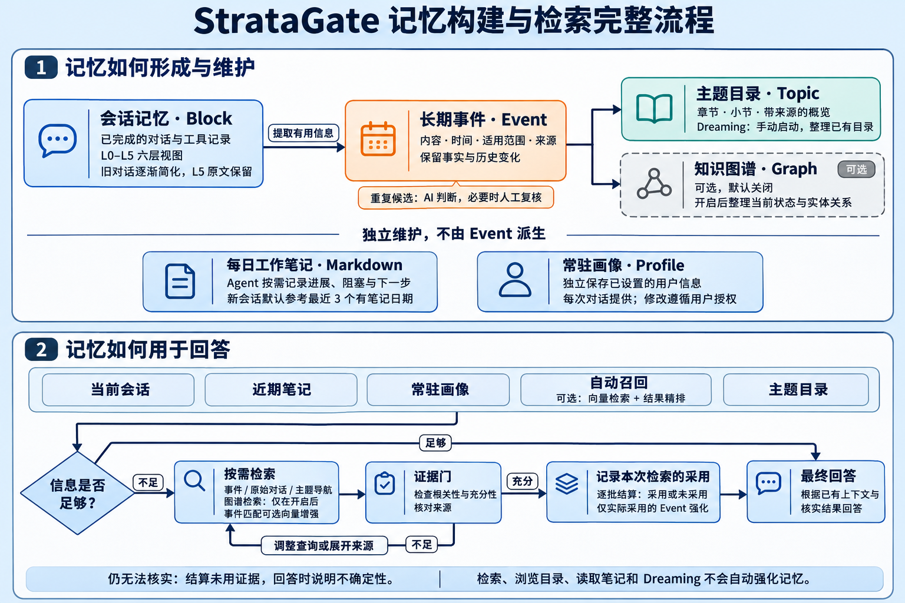
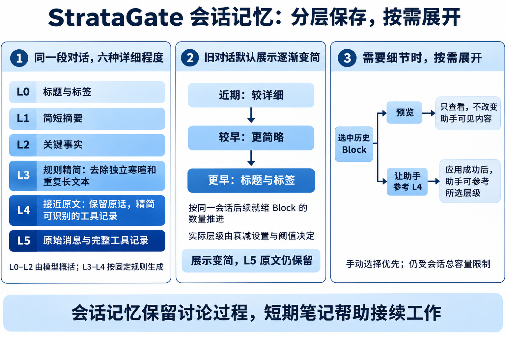
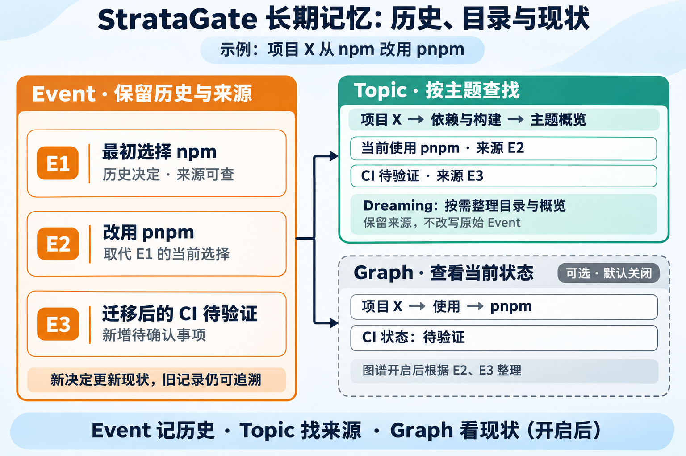

<div align="center">


# StrataGate

项目源码、版本发布和问题反馈请前往 [GitHub](https://github.com/diqierjia/StrataGate-AgentMemory)；[Gitee](https://gitee.com/diqier4123/StrataGate-AgentMemory) 保留为同步仓库。

### 近期对话保留细节，远期记忆逐渐简化。

StrataGate 是 DeepSeek Harness 的跨会话记忆插件。每日笔记帮助接续近期工作，分层会话保留可展开的历史细节，长期事件与主题目录保存重要信息并帮助查找来源。知识图谱、向量检索和结果精排可按需启用。

<p align="center">
  <a href="https://github.com/diqierjia/StrataGate-AgentMemory/actions/workflows/ci.yml"></a>
  <a href="https://www.npmjs.com/package/stratagate-dsh"></a>
  <a href="LICENSE"></a>
  <a href="https://github.com/diqierjia/StrataGate-AgentMemory/stargazers"></a>
</p>

[English](README.md) · [DeepSeek Harness 插件说明](docs/DSH.zh-CN.md) · [架构说明](docs/ARCHITECTURE.md) · [完整评测](docs/EVALUATION.md)

<strong>公开评测：</strong>在 LoCoMo 单个对话样本 `conv-26` 的 152 道题上，每个答案经过 10 次独立评审，平均判定正确率为 <strong>80.46%</strong>，Mem0 base 为 <strong>63.22%</strong>。这组结果对应 R8 评测配置。[查看评测范围](#experimental-results)。

</div>

---

<div align="center">

<h3 align="center">社区与下载</h3>

<table align="center">
  <tr>
    <td align="center">
      <a href="https://dshfind.com/zh/plugins/diqierjia/StrataGate-AgentMemory?ref=badge">
        
      </a>
    </td>
    <td align="center">
      <strong>npm 下载统计</strong><br /><br />
      <a href="https://www.npmjs.com/package/stratagate-dsh"></a><br />
      <a href="https://www.npmjs.com/package/stratagate-dsh"></a>
    </td>
  </tr>
</table>

<p align="center">
  <a href="https://awesome-dsh-plugin.com"></a>
  <a href="CONTRIBUTING.zh-CN.md"></a>
</p>

</div>

---

## 为什么选择 StrataGate？

1. **近期工作有笔记，历史对话可展开。**

   (1) **每日笔记接续工作。** Agent 按天记录进展、阶段结果、有效失败经验、阻塞和下一步。新会话默认带入最近三个有笔记日期的内容，减少重复交代背景。

   (2) **会话记忆近期详细，远期简略。** 同一段对话保存为 L0–L5 六种详细程度的视图。随着后续对话积累，较早对话逐渐变为关键事实、简短摘要和标题索引，减少历史内容对上下文的占用。→ [分层会话记忆](#layered-memory)

   (3) **展示变简，原始记录保留。** 完整的 L5 原始消息与工具记录仍然保存。需要核对细节时，Agent 可以按需展开，找回当时的原话和上下文。→ [分层会话记忆](#layered-memory)

   

2. **长期记忆保留重要信息，帮助查找来源和追溯变化。**

   (1) **事件记录“发生过什么”。** 重要决定、偏好、要求和变化会被整理为 Event，保留适用范围、时间和来源。重复候选由 AI 判断，难以确定的内容可交给用户复核，处理历史可以追溯。→ [事件记忆](#event-cards)

   (2) **主题目录说明“记过哪些内容”。** 相关事件整理为章节、小节和带来源的概览。Agent 可以先浏览主题，再查找具体事件；用户也可以启动 Dreaming，让专门的 Agent 检查和整理已有目录。→ [主题目录](#memory-topics)

   (3) **知识图谱按需整理当前状态。** 开启后，图谱根据事件整理人物、项目、工具等实体的当前信息与关系，并保留来源。图谱默认关闭，不影响事件卡、主题目录和普通检索的使用。→ [当前状态图谱](#current-state-graph)

   (4) **检索方式可以按需增强。** 默认使用关键词等检索机制；配置向量模型后，可以补充语义相近的事件。还可单独配置精排模型，调整自动召回结果的顺序。

   (5) **支持迁移其他 AI 的记忆。** 导入内容可以整理为可追溯的长期事件，原始导入内容仍会保留。→ [外部记忆导入](#external-memory-import)

3. **证据门：回答前先检查检索到的证据是否够用。**

   每日笔记帮助接续工作，主题概览帮助定位内容；需要核实历史事实时，继续查找来源事件或原始记录。搜索结果相关，不代表足以回答当前问题。Agent 会判断证据是否充分，不足时继续搜索或展开，仍无法确认时明确说明不确定性。→ [证据门](#evidence-gate)

4. **检索命中不会自动强化记忆。**

   搜索命中、自动带入上下文和浏览主题目录都不会触发强化。在检索后的采用流程中，只有被记录为最终答案实际采用的 Event，才会增加采用计数、更新衰减起点；采用越多，之后衰减越慢。主动保存记忆时，确认与已有有效事实完全重复的信息，也可强化已有记录。→ [权重与采用强化](#use-only-reinforcement)

开始使用：→ [快速开始](#quick-start-deepseek-harness)

<a id="quick-start-deepseek-harness"></a>

## 快速开始：DeepSeek Harness

已安装 DeepSeek Harness？可复制下面的提示词交给 Agent 安装：

```text
请根据 https://github.com/diqierjia/StrataGate-AgentMemory/blob/main/docs/DSH.zh-CN.md，为我当前使用的 DeepSeek Harness profile 安装 StrataGate，检查版本兼容性并验证插件是否加载成功；需要重启或无法确定 profile 时请提示我。
```

也可以手动安装（将 `web` 替换为你使用的 profile 名称）：

```bash
dsh plugin --profile web add stratagate-dsh
```

重启对应 profile 后即可使用，插件会自动记录对话并整理记忆。查看记忆：**DSH 设置 → StrataGate-AgentMemory**。

配置、兼容版本和故障处理见[插件使用说明](docs/DSH.zh-CN.md)。

<a id="how-stratagate-works"></a>

## 它如何工作



StrataGate 一边保存对话来源，一边整理近期工作与长期信息；回答时先使用已有上下文，缺少细节再检索。

1. **保存会话，保留原文。** 已完成的对话组成记忆块（Block），保存为 L0–L5 六种详细程度的视图。旧 Block 默认展示逐渐变简，需要时可以重新展开；完整原始记录仍然保留。
2. **维护每日笔记，接续近期工作。** Agent 按需记录进展、阶段结果、有效失败经验、阻塞和下一步，每个记忆空间每天一份 Markdown。新会话默认带入最近三个有笔记日期的内容，帮助继续之前的工作。
3. **整理长期信息，建立查找入口。** 有后续用途的事实、决定、偏好和要求被提取为事件（Event），保留时间、适用范围和来源。主题目录把相关事件组织为章节、小节和概览；开启知识图谱后，再根据事件整理当前状态与关系。
4. **回答时使用上下文，按需补充细节。** 插件提供当前会话、已设置的常驻画像、近期笔记、少量相关记忆和简短主题目录。已有信息足够时直接回答；不足时，Agent 可以搜索事件或原文，也可以先浏览主题，再沿来源查找。开启图谱后，还可检索实体与关系。
5. **核对证据，记录实际采用。** 对显式检索得到的证据，Agent 判断是否足以回答；不足时继续查找，充分时据此回答，并记录实际采用的 Event，用于更新记忆权重。仅搜索、浏览目录或读取笔记不会触发强化。

自动召回最多带入 **4 条 Event**；开启图谱后，还可带入最多 **4 个图谱节点**，共享约 **900 tokens** 的预算。主题目录另有约 **400 tokens** 的预算；每日笔记、常驻画像、分层会话和尚未封存的对话分别提供。

## 核心设计

不同类型的记忆分别解决不同问题：

| 组成 | 保存什么 | 主要用途 |
| --- | --- | --- |
| **每日笔记** | 近期进展、结果、阻塞和下一步 | 新会话接续工作 |
| **会话记忆 Block** | 同一段对话从索引到原文的六层视图 | 减少默认历史内容，需要时找回细节 |
| **事件记忆 Event** | 有后续用途的信息及其时间、范围和来源 | 查找事实、决定与历史变化 |
| **主题目录 Topic** | 相关事件的章节、小节和带来源概览 | 从大概印象找到具体记忆 |
| **知识图谱 Graph（可选）** | 根据事件整理的当前状态和实体关系 | 查询当前情况及关联信息 |
| **常驻画像 Profile** | 每次对话都需要参考的用户信息 | 持续提供语言、称呼等已设置偏好 |

每日笔记由 Agent 维护，Graph 和 Topic 从 Event 派生，Profile 单独保存。会话记忆的简化和 Event 的权重衰减都随对话进度推进，不按现实中经过的天数计算。

<a id="daily-notes"></a>

### 1. 短期记忆：用每日笔记接续工作

Agent 按需把工作进展、阶段结果、有效失败经验、阻塞和下一步写成每日笔记。每个记忆空间每天保存一份 Markdown，帮助新会话快速了解“之前做到哪里，接下来做什么”。

例如，一份项目笔记可以记录：

```text
项目 X：依赖迁移

已完成：项目改用 pnpm。
待确认：迁移后的 CI 是否通过。
下一步：运行 CI，检查构建与测试结果。
```

**新会话默认参考近期笔记。** 默认带入最近三个有笔记日期的内容，可以在设置中调整为 1–30；更早的笔记仍可按日期或关键词查找。每个会话首次加载时固定一份笔记快照，后续写入不会反复改变这份上下文，需要时可重新读取最新内容。

**笔记用于接续工作，历史事实仍可查证。** 笔记由 Agent 维护，不是完整对话记录。需要核实某项决定、时间或原因时，继续检索事件和原始消息；读取笔记不会触发记忆强化。

可在 **DSH 设置 → StrataGate-AgentMemory → 短期记忆** 中查看笔记。关闭每日笔记功能后，停止写入和自动带入，已有文件保留。

<a id="layered-memory"></a>

### 2. 会话记忆：旧对话逐渐简化，需要时找回细节

每日笔记概括近期工作，会话记忆保留当时的讨论过程。StrataGate 为同一段对话保存多种详细程度的视图，随着后续对话积累，逐渐减少旧对话默认带入的内容。



**同一段对话，保存为六种详细程度。**

DeepSeek Harness 插件默认每 **6 轮**完整对话封存一个记忆块（Block），一轮指一次用户提问和助手的完整回复。封块大小可以配置，尚未达到边界的内容继续保留在当前对话中。

| 层级 | 保存的内容 | 主要用途 |
| --- | --- | --- |
| **L0** | 标题和标签 | 标识这段历史 |
| **L1** | 简短摘要 | 快速了解讨论主题 |
| **L2** | 关键事实 | 查看决定、约束、计划和结果 |
| **L3** | 按固定规则精简的对话 | 删除独立寒暄和重复长文本，精简工具记录 |
| **L4** | 接近原文的可读对话 | 保留用户和助手原话，精简可识别的工具记录 |
| **L5** | 原始消息与工具记录 | 核对原话、完整上下文和工具结果 |

L0–L2 由模型概括；L3/L4 由固定规则生成。L3 会进一步删除冗余内容，L4 尽量保留原话。**这些视图都不会覆盖 L5 原始记录。**

<details>
<summary>具体精简规则、衰减公式与层级阈值</summary>

L0–L2 由模型概括生成；L3、L4 不调用模型改写，而是由程序按以下固定规则生成：

- **L4：** 删除 system 消息；用户和助手正文只裁剪首尾空白并添加 `User`、`Assistant` 等角色标签。对于能够识别的结构化工具记录，只保留工具名称和最长 160 字符的结果摘要，省略原始 `arguments`、`params`、`input` 和 `request`；无法识别为工具 JSON 的 tool 正文保持原样。
- **L3：** 在不改写语义的前提下进一步精简。只有当整句去掉末尾标点后命中固定白名单时，才删除 `ok`、`thanks`、`好的`、`明白`、`收到`、`谢谢`、`可以` 等独立寒暄或确认。程序把连续空白合并并忽略大小写后，对代码型段落或至少 80 字符的长段落去重：第一次保留原文，之后的完全重复内容替换为省略标记。工具记录采用与 L4 相同的名称和结果摘要形式。
- **长度保护：** 如果生成的 L4 比 L5 更长，就直接使用 L5；如果 L3 比 L4 更长，就直接使用 L4，确保 `L3 ≤ L4 ≤ L5`。

原始记录先保存，摘要和事件处理随后进行。只有处理完成、进入就绪状态的 Block，才会替换对应的原生历史并参与衰减。

**后续对话越多，旧 Block 默认展示得越简略。**

Block 的展示变化由指数衰减控制：

<p align="center"><strong>w<sub>block</sub>(age) = e<sup>−λ<sub>block</sub> · age</sup></strong></p>

其中，衰减系数 λ<sub>block</sub> 默认取 **0.30**，程序根据权重区间选择当前展示层级。系数越小，详细内容保留得越久，相应占用的上下文也越多。

公式中的 `age` 按当前展示锚点与同一会话最新就绪 Block 之间的距离计算。它衡量的是对话积累的进度，**不是现实中经过的天数**。尚未封存的对话，以及仍在等待模型处理的 Block，都不会推动这项衰减。

例如，一个从 L5 开始、期间没有重新展开的 Block，在默认参数下会经历：

| 后续新增的就绪 Block 数量 | 默认展示层 |
| ---: | --- |
| 0–1 | L5 |
| 2 | L4 |
| 3–4 | L3 |
| 5–6 | L2 |
| 7–8 | L1 |
| 9 及以上 | L0 |

图中的层级变化用于展示趋势，实际变化由衰减参数和层级阈值共同决定，并非每新增一个 Block 就下降一级。

</details>

**后续对话越多，旧 Block 默认展示得越简略。**

会话记忆按后续就绪 Block 的数量推进简化，不按现实中经过的天数计算。衰减参数决定详细内容保留多久，可以在设置中调整。

**需要细节时，Agent 可以展开来源，用户也可以手动选择。**

例如，旧对话目前只显示“讨论了项目技术方案”。用户追问“当初为什么选择 pnpm”，Agent 可以读取更详细的对话或原始记录，查找当时的理由。

界面中的“分层内容预览”只用于查看；点击“让助手参考 L4”等按钮后，才会尝试把所选内容应用到会话。界面会区分已经生效、等待生效和无法应用的情况。

用户手动选择的层级优先于自动压缩和 Agent 的证据读取。上下文放不下时，系统会先尝试简化其他自动管理的历史，保留其他手动选择；仍然不足时说明原因。手动选择会重设衰减起点，随着后续对话积累，仍可继续逐渐变简。

<a id="event-cards"></a>

### 3. 长期记忆：保留重要信息，查找来源与历史变化

长期记忆把有后续用途的信息整理为事件（Event），再通过主题目录帮助查找。知识图谱可按需开启，用于整理当前状态与关系；常驻画像 Profile 单独保存，为每次对话提供已设置的用户信息。



图中数据为示例，图谱部分表示开启后的功能。

#### 3.1 事件记忆：记住有后续用途的信息

重要事实、决定、偏好、要求和变化可以保存为 Event。每条事件保留内容、适用范围、来源消息，以及能够确定的时间信息。同一个 Block 可以产生多条事件，也可以没有需要提取的内容。

| 时间 | 表示什么 |
| --- | --- |
| 提及时间 | 这件事什么时候在对话中被说到 |
| 发生时间 | 事情实际发生或计划发生的时间 |

例如，用户在 5 月 6 日说“下周完成原型”，5 月 6 日是提及时间，“下周”描述计划完成时间。这条记录不能当作“原型已经完成”的证据；无法确定的时间保留原始表达和不确定性。

**保存有用的信息，而不是逐项记录执行步骤。** 用户的明确要求、纠正和改变决定，以及已确认的根因、平台限制、失败条件和重要结果，都可能值得保留。普通读文件、运行工具和重复测试不会仅因发生过就各自生成事件。

记录也需要区分适用范围。例如，“这张图的箭头要对齐”属于当前任务，不能自动扩大成永久审美偏好。Agent 还可通过主动记忆工具保存值得以后想起的信息，不必等待对话封块。

具体判断规则见[事件提取说明](docs/event-extractor.md)。

#### 3.2 记忆更新：区分补充、变化、冲突和重复

新信息可能带来不同的更新：

| 新信息 | 如何理解 |
| --- | --- |
| “项目从 npm 改用 pnpm” | 更新当前选择，保留原来的决定及其来源 |
| “迁移后的 CI 待验证” | 补充待确认事项，不代表测试已经通过 |
| 两种说法矛盾，无法确定哪条有效 | 保留冲突，等待进一步核实 |
| 多条记录可能描述同一件事 | 检查完整内容与来源，再决定是否合并 |

**相似不等于重复，后续进展也不等于旧记录无用。** 程序发现重复候选后，由 AI 结合双方内容和来源判断；明确不同的事实可以同时保留，不确定或未完成的候选交给用户复核。

用户可以查看双方来源、编辑合并稿、保留其中一条或同时保留。处理过程保留历史，并提供撤销入口，便于追溯整理前后的变化。

<a id="current-state-graph"></a>

#### 3.3 知识图谱：按需了解当前状态和关系

知识图谱根据 Event 整理人物、项目、组织、工具和地点，以及“使用”“参与”“依赖”等关系。节点属性和关系保留来源，帮助回答“现在是什么情况”“这些事物有什么联系”。

在示例中，“项目使用 pnpm”表示当前选择，“CI 待验证”表示尚未确认的结果；只有新的来源证据确认后，才更新相应状态。

**图谱默认关闭，其他记忆功能仍可使用。** 开启图谱会额外调用模型整理实体和关系。可以在 **更多 → 高级设置 → 记忆配置 → 启用知识图谱** 中操作；存在待补建的历史事件时，先显示处理数量，确认后开始。

关闭图谱会停止相关处理、查询和自动召回，已有图谱数据及其来源保留。事件卡、主题目录、普通检索和常驻画像独立工作。

<a id="memory-topics"></a>

#### 3.4 主题目录：从大概印象找到具体记忆

知道关键词时，可以直接检索；只记得“大概聊过某件事”时，可以先浏览主题目录。

一个 Topic 对应持续存在的主题，例如“项目 X”；章内小节容纳“依赖与构建”等相关事项。按需展开的概览整理背景、进展、决定、变化和待确认问题，并链接来源事件。

例如，用户问“之前项目技术方案讨论到哪了”，Agent 可以先找到主题、查看概览，再查找具体事件，核对已确定的方案和待决定的问题。

**Dreaming 帮助整理已有目录。** 用户可以从目录页启动专门的 Agent，让它检查已有事件和概览，调整章节、小节、事件归属及概览内容。运行过程可以查看、暂停、继续或终止；已经保存的修改保留。

Dreaming 整理的是目录与概览，不改写原始 Event 事实，也不因整理或读取而强化记忆。**目录帮助定位，具体事实仍需沿来源查证。**

<a id="persistent-profile"></a>

#### 3.5 常驻画像：每次对话都需要知道的用户信息

常驻画像保存需要持续参考的用户信息，与按相关性查找的事件、仅本次有效的要求分开：

| 用户表达 | 保存位置 | 什么时候使用 |
| --- | --- | --- |
| “以后默认用中文回答” | 常驻画像 Profile | 设置后跨会话自动提供 |
| “这个项目已经改用 pnpm” | 长期事件 Event | 在相关问题中召回或检索 |
| “这次回答简短一点” | 当前对话 | 用于本次回答 |

“记住”一词本身不决定保存位置。用户明确要求修改画像时可以直接应用；由 Agent 推断的画像变化，需要先说明拟修改的字段与内容，并取得用户同意。

画像字段、地点选择和设置方式见[插件使用说明](docs/DSH.zh-CN.md)。

<a id="evidence-gate"></a>

### 4. 检索与证据门：找到相关内容，再确认是否足以回答

已有上下文足够时，Agent 可以直接回答；需要历史信息时，再搜索事件、原始对话，或先浏览主题目录。开启知识图谱后，还可查找实体与关系。

**检索方式可以按需增强。**

| 方式 | 作用 |
| --- | --- |
| 默认检索 | 根据关键词等信息查找相关记录 |
| 向量检索（可选） | 补充说法不同、意思接近的事件 |
| 结果精排（可选） | 重新排列自动召回的候选，让更相关的记忆优先进入上下文 |

向量检索与精排分别配置，未配置时不启用。精排只作用于自动召回，超时或出错时回退原顺序。**排序靠前、语义相似或权重较高，都不代表内容一定正确，也不代表足以回答当前问题。**

**没有搜到，不等于从未记录。**

空结果可能与当前记忆范围、关键词或筛选条件有关。Agent 应根据问题调整查找方式，不能仅凭一次空结果断言“你没有说过”。检索发生错误时，也应说明实际问题。

**证据门检查找到的内容是否回答了问题。**

例如，用户问“为什么当初改用了 pnpm”：

| 步骤 | 找到的内容 | 应如何处理 |
| --- | --- | --- |
| 找到主题 | “项目技术选型”的概览提到换了包管理器 | 沿来源查找具体事件 |
| 检索事件 | “项目已从 npm 改为 pnpm” | 只能确认变更，原因仍缺失，继续展开 |
| 核对原文 | 示例原话：“安装更快，也更适合我们的多包结构” | 核对项目和时间后，按来源解释原因 |

这里的原话是演示用例。若来源没有说明原因，Agent 应明确无法确认，不能根据 pnpm 的一般优点推测当时的决定。

证据是否充分由模型判断，程序检查来源引用和检索流程。显式检索结果需要完成证据评估，并记录实际采用的内容；没有采用的结果也需完成收尾。证据不足时继续查找，仍无法核实时说明不确定性。

<details>
<summary>证据评估字段与流程检查</summary>

| 评估项 | 需要说明的内容 |
| --- | --- |
| `verdict` | 证据充分、部分充分，还是与问题不符 |
| `evidence_refs` | 哪些检索结果支持当前判断 |
| `fit` | 证据与问题具体匹配在哪里 |
| `missing` | 还缺少哪些信息 |
| `next_strategy` | 直接回答，还是继续搜索或展开 |

引用必须来自指定检索批次；接受 `sufficient` 时，需要有效证据引用，并明确选择回答。采用记录只包含实际用于答案的证据，没有采用则提交空列表。接口说明见[插件指南](docs/DSH.zh-CN.md)。

</details>

<a id="use-only-reinforcement"></a>

### 5. 记忆强化：检索不强化，实际采用后更新权重

Event 的权重参与后续召回和排序。未被采用时，权重随对话轮次逐渐降低，但事件及其来源仍然保留；这与会话 Block 的 L0–L5 展示简化是两种机制。


**被搜索到或展示出来，不会触发强化。**

搜索命中、自动带入上下文、浏览目录、展开概览和读取每日笔记，都不会仅因内容出现而增加采用计数或重置衰减起点。

**实际用于回答的 Event 才获得本次采用强化。**

Agent 选定用于最终回答的证据后，提交采用记录。程序检查证据所属批次及评估结果，通过后增加对应 Event 的采用计数、更新衰减起点，并避免同一次操作重复执行。没有使用的结果不获得这次强化。

采用次数越多，之后的衰减越慢，让持续帮助回答的记忆保持较高的召回优先级。

**主动写入时，确认重复也可以强化已有事实。**

使用主动记忆工具保存信息时，规范化后全文一致的当前有效事实，可以直接强化已有记录。其他相似内容需要进一步判断，决定新增、合并、取代、标记冲突或忽略，不能仅凭文字相似直接强化。

重复卡整理与回答采用也有区别：合并可以保留双方已有的采用信息，但不会把整理操作冒充一次新的回答采用。

**不同类型的记忆保留不同的最低权重。**

| 记忆类别 | 默认最低权重 |
| --- | ---: |
| 普通信息 | 0 |
| 用户偏好 | 0.3 |
| 身份信息 | 0.9 |
| 安全信息 | 1.0 |

置顶记忆的有效权重保持为 1；被取代的事件通常设置较低的权重上限，减少旧状态继续优先出现的机会。

这些权重用于管理召回优先级，不是事实正确率。需要核实的内容仍应结合最新状态和来源判断。

<details>
<summary>长期权重公式与计数含义</summary>

**新事件具有初始权重，未被采用时逐渐衰减。**

长期 Event 的基础权重函数为：

<p align="center"><strong>w(t,n) = max(floor, e<sup>−λ(n)t</sup>)</strong></p>

<p align="center"><strong>λ(n) = 0.15 / (1 + 1.5 ln(n))</strong></p>

其中：

- `t` 是当前轮次与最近一次强化锚点的差，新事件从创建时开始计算；
- `n` 是内部计数，初始化为 1；答案采用或主动记忆重复确认时增加，单纯检索不增加；
- `floor` 是根据记忆重要程度设置的最低权重。

长期权重衰减同样按对话轮次计算，而不是按现实时间计算。较低的权重可能降低一条记忆在后续召回中的优先级，但不会因衰减而删除它的历史记录。

</details>

<a id="model-configuration"></a>

## 模型配置与升级

**聊天与记忆处理可以使用不同模型。**

| 模型用途 | 负责什么 | 如何选择 |
| --- | --- | --- |
| 聊天模型 | 与用户对话、回答问题 | 在 DSH 中选择 |
| 记忆处理模型 | 会话压缩、事件提取、目录整理和 Dreaming | 跟随聊天模型，或单独指定 |
| 向量模型（可选） | 按语义查找相关事件 | 单独配置 |
| 精排模型（可选） | 调整自动召回候选的顺序 | 单独配置，可独立于向量检索使用 |

在 **更多 → 高级设置 → 宿主配置 → 记忆处理模型** 中，选择“跟随聊天模型”或“单独指定模型”，保存后用于后续记忆处理，聊天主模型保持原来的选择。已经运行的请求继续完成。

记忆处理模型使用 DSH 已配置的服务商和模型。建议选择支持工具调用、上下文容量足够的模型；指定模型不可用时，任务会保留失败状态，不会自动改用聊天主模型。

**向量检索与精排分别开启。**

在高级设置中，分别填写对应服务的 API 地址、密钥和模型，再保存设置。配置完整后才启用；清空地址并保存即可停用。

向量模型负责补充语义匹配，精排模型负责调整自动召回顺序。它们不替代事件来源，也不替代证据门的判断。

**升级后重启对应的 DSH profile。**

当前版本覆盖 DSH **0.2.x** 及其预发布版，并保留已支持的旧版适配；DSH **0.3.x** 暂不支持。完整版本范围、旧版修复和恢复方式见[插件使用说明](docs/DSH.zh-CN.md)。

会话来源和长期记忆保存在本地 SQLite，每日笔记单独保存为 Markdown。卸载插件不会自动删除这些数据。

<a id="external-memory-import"></a>

## 外部 AI 记忆迁移

可以导入其他 AI 导出的记忆总结。StrataGate 将重要信息整理为 Event，与已有记忆比较，并保留原始导入内容供追溯。

DSH 管理界面提供导入预览：重复内容可以忽略，变化可以新增、合并或取代旧状态，不确定的关系可以标为冲突。低置信度项可人工选择处理方式，提交后可按批次撤销。旧事件及其来源仍会保留。

导出格式、提示词与接入示例见[外部记忆导入说明](docs/EXTERNAL_MEMORY_IMPORT.zh-CN.md)。

<a id="实验结果"></a>
<a id="experimental-results"></a>

## 评测结果与边界

仓库公开的 R8 对比评测使用 LoCoMo 中的 `conv-26` 对话样本，包含 **419 条消息、35 个会话和 152 道问题**，覆盖 category 1–4。

**以下为仓库公开的 R8 评测结果，具体测试版本、模型和检索配置见[评测文档](docs/EVALUATION.md)。**

两个系统分别生成答案，再对每道题的答案进行 **10 次独立 Judge 评审**。这里的十次指评审重复次数，不代表十次完整系统运行。

| 指标 | StrataGate | Mem0 base | 差值 |
| --- | ---: | ---: | ---: |
| 10 次评审平均准确率 | **80.46%** | 63.22% | **+17.24 个百分点** |
| 多数票正确 | **121 / 152（79.61%）** | 96 / 152（63.16%） | **+25 题** |
| 时间类问题（Temporal） | **74.86%** | 34.59% | **+40.27 个百分点** |
| 单跳问题（Single-hop） | **89.29%** | 75.14% | **+14.14 个百分点** |
| 多跳问题（Multi-hop） | **66.56%** | 61.56% | +5.00 个百分点 |
| 开放域问题（Open-domain） | 83.08% | **84.62%** | -1.54 个百分点 |

两边使用相同的问题、顺序、答案模型、Judge 模型、评审提示词、解析器和评审次数，并分别重新构建记忆。记忆抽取、检索实现、embedding 使用方式和回答上下文存在差异，因此这里比较的是两套完整系统配置。

这组结果仅覆盖 `conv-26`，不代表完整 LoCoMo 成绩，也不能单独证明会话记忆的展示衰减、知识图谱或证据门中某一项机制带来的收益。各组件的独立作用仍需通过消融实验检验。

完整协议、逐题结果及评审波动见 [评测文档](docs/EVALUATION.md)，汇总数据见 [机器可读评测结果](benchmarks/locomo-conv26-r8-final.json)。

上述 R8 评测中，仍有 **31 道题被多数评审判为错误**。按可观察到的失败阶段划分：

| 失败阶段 | 题数 | 反映的问题 |
| --- | ---: | --- |
| 未发起检索，直接回答错误 | 15 | Agent 有时未意识到需要查找历史证据 |
| 证据被判为充分，最终答案仍然错误 | 14 | 证据可能属于相邻事件，或不足以支持完整答案 |
| 达到检索预算时，证据仍不充分 | 2 | 在给定预算内没有找到足够的信息 |

这些结果说明，在该评测范围内，仍需改进何时发起检索，以及如何判断证据是否真正回答了问题。证据门能够约束引用和评估流程，但不能保证模型的语义判断或最终答案一定正确。

R1–R8 的设计演变、逐题分析与后续验证方向见[完整评测](docs/EVALUATION.md)。

<a id="代码入口"></a>
<a id="code-entry-points"></a>

## 开发与文档

本节面向开发者。直接使用 DeepSeek Harness 插件的用户，可以按照 [快速开始](#quick-start-deepseek-harness)安装，无需自行构建仓库。

开发环境需要：

- Node.js **22.19.0 及以上的 22.x 版本**，或 **24.0.0 及以上版本**；
- 对应的版本声明为 `^22.19.0 || >=24.0.0`。

检出仓库后，在仓库根目录运行：

```bash
npm install
npm run check
npm test
npm run build
```

| 资源 | 内容 |
| --- | --- |
| [DeepSeek Harness 使用说明](docs/DSH.zh-CN.md) | 安装、配置、界面、记忆工具和恢复机制 |
| [记忆目录与主题概览](docs/MEMORY_TOPICS.zh-CN.md) | 章节与小节、来源追溯、后台整理、预算和恢复 |
| [事件提取规则](docs/event-extractor.md) | 提取判断、适用范围、重复与历史关系，以及兼容边界 |
| [Dreaming 目录整理](https://github.com/diqierjia/StrataGate-AgentMemory/blob/main/docs/dreaming-agent.md) | 目录整理范围、运行控制、来源保护与恢复 |
| [可选知识图谱](https://github.com/diqierjia/StrataGate-AgentMemory/blob/main/docs/knowledge-graph.md) | 默认状态、开启、暂停、关闭及历史补建 |
| [手动层级选择](https://github.com/diqierjia/StrataGate-AgentMemory/blob/main/docs/user-operation-priority.md) | 内容预览、实际应用、容量不足与恢复操作 |
| [架构文档](docs/ARCHITECTURE.md) | 分层规则、事件与图谱、检索、证据门、权重、存储和核心 API |
| [外部记忆导入](docs/EXTERNAL_MEMORY_IMPORT.zh-CN.md) | 导出格式、导入流程和接入示例 |
| [完整评测](docs/EVALUATION.md) | 实验协议、版本演变、失败分析和结果范围 |
| [评测汇总数据](benchmarks/locomo-conv26-r8-final.json) | 已公开运行的结果、统计和产物信息 |
| [核心引擎示例](packages/core/examples/basic.ts) | 最小 API 接入示例 |

核心实现位于 `packages/core/`，DSH 适配层位于 `src/`。分层规则见 [blocks.ts](packages/core/src/blocks.ts)，长期权重见 [weights.ts](packages/core/src/weights.ts)。

核心 API 接入、持久化及采用回执的幂等处理见[架构说明](docs/ARCHITECTURE.md)，最小用法见[核心引擎示例](packages/core/examples/basic.ts)。

## 参与贡献

欢迎各种形式的贡献：修复问题、完善文档、增加集成，或探索更好的记忆与检索方案都可以。

请先阅读 [`CONTRIBUTING.zh-CN.md`](CONTRIBUTING.zh-CN.md)，其中包含 monorepo 开发环境、检查与测试命令、适合参与的方向，以及提交 Pull Request 的建议。如果还不确定一个想法是否适合项目，建议先[创建 Issue](https://github.com/diqierjia/StrataGate-AgentMemory/issues)，再投入较大的改动。

## 贡献者

<a href="https://github.com/diqierjia/StrataGate-AgentMemory/graphs/contributors">
  
</a>

## 许可证

StrataGate 使用 [MIT License](LICENSE)。
