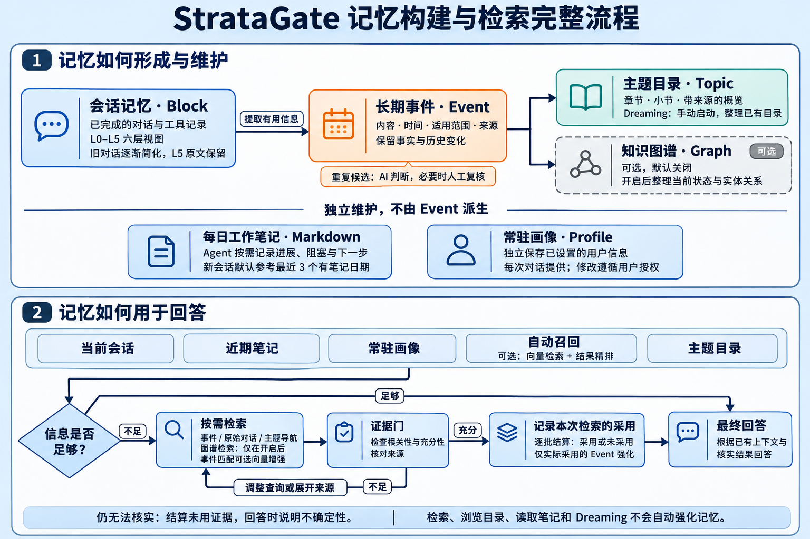
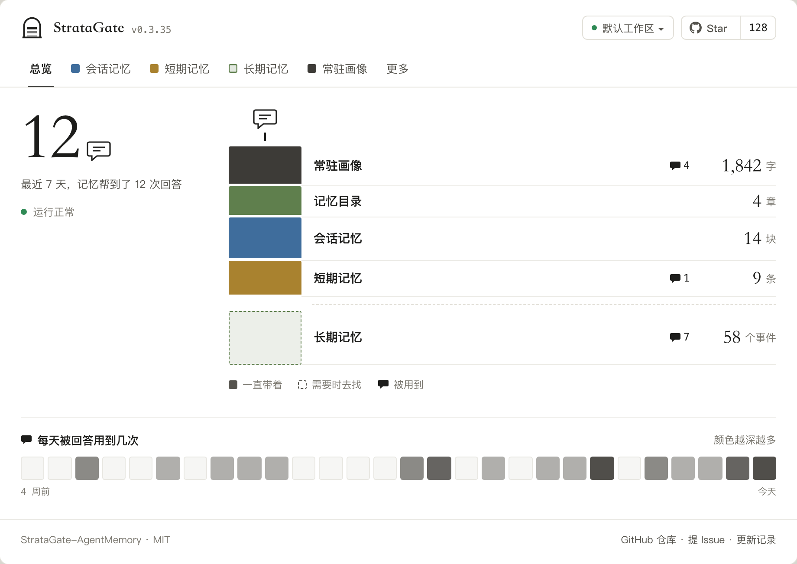
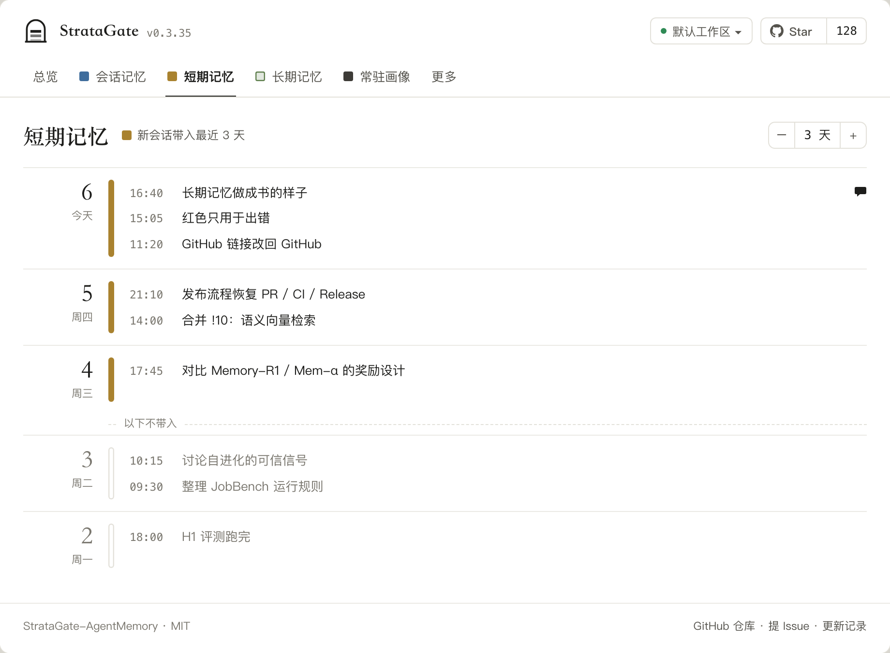
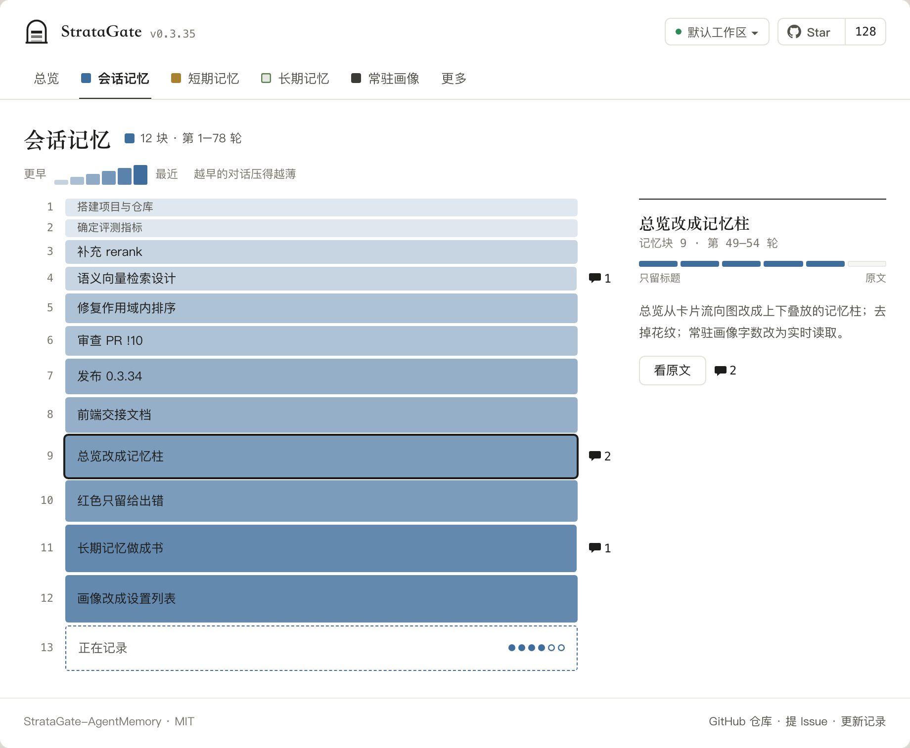
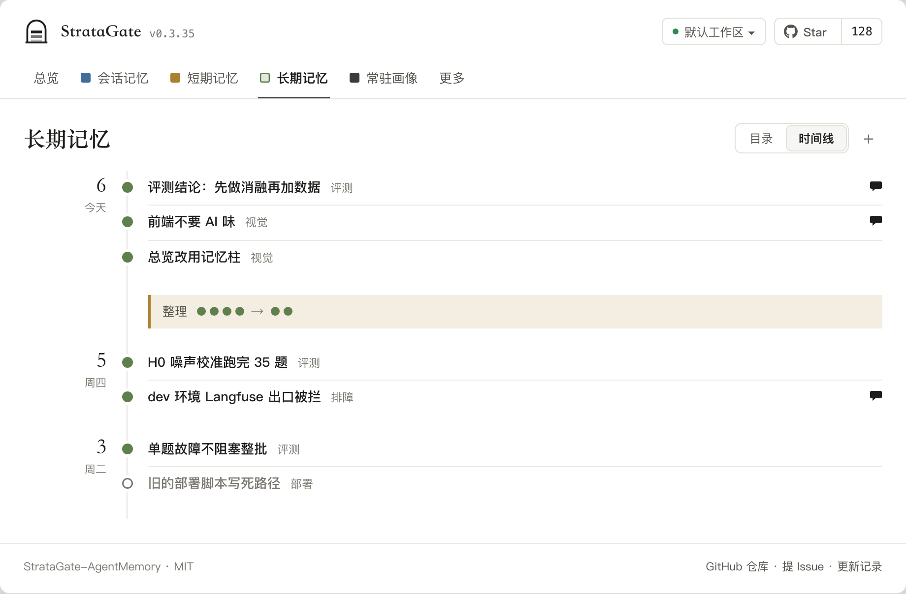
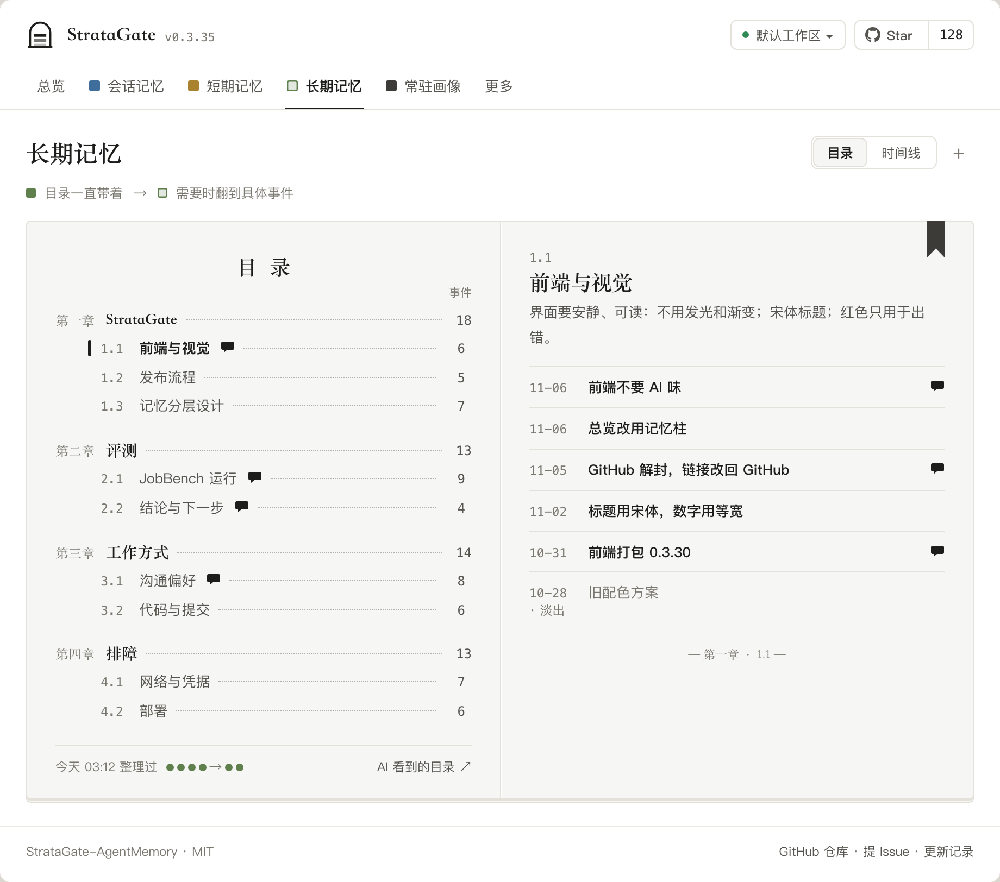
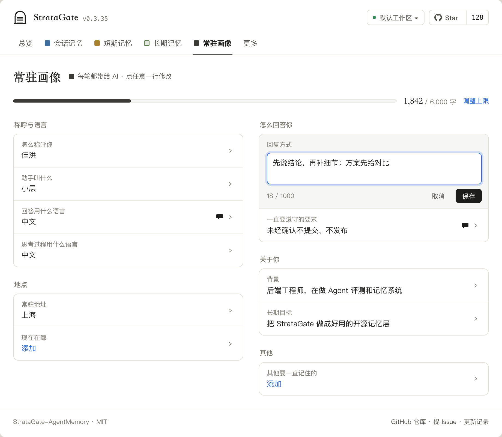
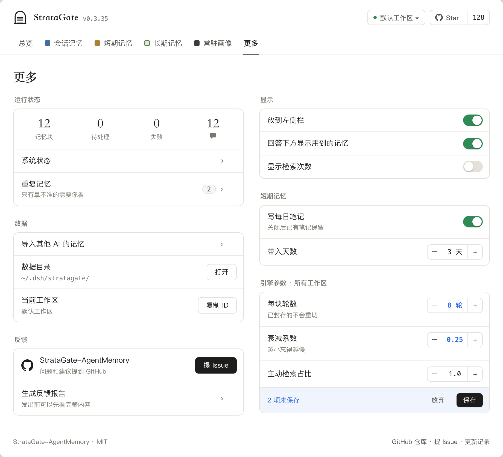

<div align="center">


# StrataGate

### 近期对话保留细节，远期记忆逐渐简化。

StrataGate 是 DeepSeek Harness 的跨会话记忆插件。每日笔记帮助接续近期工作，分层会话保留可展开的历史细节，长期事件与主题目录保存重要信息并帮助查找来源。知识图谱、向量检索和结果精排可按需启用。

<p align="center">
  <a href="https://github.com/diqierjia/StrataGate-AgentMemory/actions/workflows/ci.yml"></a>
  <a href="https://www.npmjs.com/package/stratagate-dsh"></a>
  <a href="LICENSE"></a>
  <a href="https://github.com/diqierjia/StrataGate-AgentMemory/stargazers"></a>
</p>

[English](README.md) · [DeepSeek Harness 插件说明](docs/DSH.zh-CN.md) · [机制细则与公式](docs/MEMORY_DETAILS.zh-CN.md) · [架构说明](docs/ARCHITECTURE.md) · [完整评测](docs/EVALUATION.md)

<strong>公开评测：</strong>在 LoCoMo 单个对话样本 `conv-26` 的 152 道题上，每个答案经过 10 次独立评审，平均判定正确率为 <strong>80.46%</strong>，Mem0 base 为 <strong>63.22%</strong>。这组结果对应 R8 评测配置。[查看评测范围](#experimental-results)。

</div>

---

<div align="center">

<h3 align="center">社区与下载</h3>

<table align="center">
  <tr>
    <td align="center">
      <a href="https://dshfind.com/zh/plugins/diqierjia/StrataGate-AgentMemory?ref=badge">
        
      </a>
    </td>
    <td align="center">
      <strong>npm 下载统计</strong><br /><br />
      <a href="https://www.npmjs.com/package/stratagate-dsh"></a><br />
      <a href="https://www.npmjs.com/package/stratagate-dsh"></a>
    </td>
  </tr>
</table>

<p align="center">
  <a href="https://awesome-dsh-plugin.com"></a>
  <a href="CONTRIBUTING.zh-CN.md"></a>
</p>

</div>

---

## 为什么选择 StrataGate？

1. **近期工作有笔记，历史对话可展开。** 每日笔记按天记录进展、有效失败经验、阻塞与下一步，新会话默认带入最近三个有笔记日期的内容；会话记忆将每段对话存为 L0–L5 六层视图，旧对话在上下文中逐渐简化，完整 L5 原文始终保留并可按需展开。→ [每日笔记](#daily-notes) · [分层会话记忆](#layered-memory)

   

2. **长期记忆保留重要信息，帮助追溯来源与变化。** 重要决定、偏好、要求和变更沉淀为带来源的 Event，由主题目录与 Dreaming 持续整理；知识图谱、向量检索、结果精排以及外部 AI 记忆迁移均可按需启用。→ [长期记忆](#event-cards) · [外部记忆导入](#external-memory-import)

3. **证据门：回答前先检查证据是否充分。** 每日笔记和主题概览负责定位，历史事实仍需沿来源事件或原文核实；若检索结果不足以回答当前问题，Agent 会继续查找或明确说明不确定性。→ [证据门](#evidence-gate)

4. **检索命中不会自动强化记忆。** 搜索命中、自动带入上下文、浏览目录和读取笔记都不会触发强化；只有最终回答实际采用并记录的 Event（以及主动保存时确认完全重复的已有事实），才会增加采用计数并放缓后续衰减。→ [记忆强化](#use-only-reinforcement)

开始使用：→ [快速开始](#quick-start-deepseek-harness)

<a id="quick-start-deepseek-harness"></a>

## 快速开始：DeepSeek Harness

已安装 DeepSeek Harness？可复制下面的提示词交给 Agent 安装：

```text
请根据 https://github.com/diqierjia/StrataGate-AgentMemory/blob/main/docs/DSH.zh-CN.md，为我当前使用的 DeepSeek Harness profile 安装 StrataGate，检查版本兼容性并验证插件是否加载成功；需要重启或无法确定 profile 时请提示我。
```

也可以手动安装（将 `web` 替换为你使用的 profile 名称）：

```bash
dsh plugin --profile web add stratagate-dsh
```

重启对应 profile 后即可自动记录对话并整理记忆。查看记忆：**DSH 设置 → StrataGate-AgentMemory**。配置、兼容版本与故障处理见[插件使用说明](docs/DSH.zh-CN.md)。

<a id="how-stratagate-works"></a>

## 它如何工作



StrataGate 一边保留对话来源，一边整理近期工作与长期信息；回答时先用已有上下文，缺少细节再按需检索：

1. **保存会话，保留 L0–L5 视图。** 已完成对话封存为记忆块（Block），旧块默认展示逐渐变简，完整 L5 原文随时可展开。
2. **用每日笔记接续近期工作。** 每个记忆空间每天一份 Markdown，新会话默认带入最近三个有笔记日期的内容。
3. **提取长期事件，建立查找入口。** 有后续价值的事实、决定与变更整理为带来源的 Event，归入主题目录，开启图谱后同步派生当前状态与关系。
4. **先用默认上下文，不足再检索。** 自动召回最多带入 **4 条 Event**（开启图谱后还可带入最多 **4 个图谱节点**），共享约 **900 tokens** 预算；主题目录另有约 **400 tokens** 预算；每日笔记、常驻画像、分层会话和未封存对话分别提供。
5. **核对证据，记录实际采用。** 显式检索结果需经过证据充分性评估，仅实际用于最终回答的 Event 才更新权重。

## 核心设计

不同类型的记忆分别解决不同问题：

| 组成 | 保存什么 | 主要用途 |
| --- | --- | --- |
| **每日笔记** | 近期进展、结果、阻塞和下一步 | 新会话接续工作 |
| **会话记忆 Block** | 同一段对话从索引到原文的六层视图 | 减少默认历史内容，需要时找回细节 |
| **事件记忆 Event** | 有后续用途的信息及其时间、范围和来源 | 查找事实、决定与历史变化 |
| **主题目录 Topic** | 相关事件的章节、小节和带来源概览 | 从大概印象找到具体记忆 |
| **知识图谱 Graph（可选）** | 根据事件整理的当前状态和实体关系 | 查询当前情况及关联信息 |
| **常驻画像 Profile** | 每次对话都需要参考的用户信息 | 持续提供语言、称呼等已设置偏好 |

每日笔记由 Agent 维护，Topic 与可选 Graph 从 Event 派生，Profile 单独保存。会话记忆简化和 Event 权重衰减都随对话进度推进，不按现实天数计算。

<picture>
  <source media="(prefers-color-scheme: dark)" srcset="docs/assets/stratagate-ui-overview-dark.png" />
  
</picture>

*插件总览界面：直观查看常驻带入层（常驻画像、记忆目录、会话记忆、短期记忆）、按需查找的长期记忆，以及近 4 周记忆帮助回答的频次。*

<a id="daily-notes"></a>

### 1. 短期记忆：用每日笔记接续工作

Agent 按需把进展、阶段结果、有效失败经验、阻塞和下一步写入每日 Markdown 笔记。例如，一份项目笔记可以记录：

```text
项目 X：依赖迁移

已完成：项目改用 pnpm。
待确认：迁移后的 CI 是否通过。
下一步：运行 CI，检查构建与测试结果。
```

新会话默认带入**最近三个有笔记日期**的内容（可调为 1–30；开关、时区与带入天数保存后热更新生效，无需重启），首次加载时固定快照，避免后续写入反复改动上下文；更早笔记仍可按日期或关键词检索。

<picture>
  <source media="(prefers-color-scheme: dark)" srcset="docs/assets/stratagate-ui-daily-notes-dark.png" />
  
</picture>

每日笔记用于接续工作，不能替代原始查证；需要核实决定、时间或原因时，继续检索事件与原文，读取笔记不会触发强化。快照与开关说明见[机制细则：每日笔记](docs/MEMORY_DETAILS.zh-CN.md#daily-notes)。

<a id="layered-memory"></a>

### 2. 会话记忆：旧对话逐渐简化，需要时找回细节

DeepSeek Harness 插件默认每 **6 轮**完整对话封存一个记忆块（可配置），为同一段对话保存六层视图：

| 层级 | 保存的内容 | 主要用途 |
| --- | --- | --- |
| **L0** | 标题和标签 | 标识这段历史 |
| **L1** | 简短摘要 | 快速了解讨论主题 |
| **L2** | 关键事实 | 查看决定、约束、计划和结果 |
| **L3** | 按固定规则精简的对话 | 删除独立寒暄和重复长文本，精简工具记录 |
| **L4** | 接近原文的可读对话 | 保留用户和助手原话，精简可识别的工具记录 |
| **L5** | 原始消息与工具记录 | 核对原话、完整上下文和工具结果 |

L0–L2 由模型概括，L3/L4 由固定规则生成，**均不覆盖 L5 原始记录**。随着后续就绪 Block 增多，旧 Block 默认展示逐渐变简；Agent 需要细节时可按需展开，用户也可在界面手动指定层级——手动选择优先于自动压缩并重设衰减起点。



L3/L4 精简规则、衰减公式、默认层级表与容量回退策略见[机制细则：会话记忆](docs/MEMORY_DETAILS.zh-CN.md#conversation-memory)与[架构说明](docs/ARCHITECTURE.md)。

<a id="event-cards"></a>

### 3. 长期记忆：保留重要信息，查找来源与历史变化

长期记忆把有后续用途的信息沉淀为 Event，用主题目录建立浏览入口，按需开启知识图谱，并将跨会话常驻偏好单独存于常驻画像。

#### 3.1 事件记忆与更新

重要事实、决定、偏好、要求和变化保存为 Event，保留内容、适用范围、来源消息（含按相似度抽取并标注来源性质的逐字原文引用）以及时间信息——区分**提及时间**与**发生时间**（例如 5 月 6 日说“下周完成原型”，记录的是计划时间，而非已完成证据）。常规读文件、工具调用和仅限当前任务的指示不会无差别转为长期事件。



新信息进入时，系统按与已有记忆的关系分别处理：

| 新信息 | 如何理解 |
| --- | --- |
| “项目从 npm 改用 pnpm” | 更新当前选择，保留原来的决定及其来源 |
| “迁移后的 CI 待验证” | 补充待确认事项，不代表测试已经通过 |
| 两种说法矛盾，无法确定哪条有效 | 保留冲突，等待进一步核实 |
| 多条记录可能描述同一件事 | 检查完整内容与来源，再决定是否合并 |

**相似不等于重复，后续进展也不等于旧记录无用。** 候选重复由 AI 结合来源判断，不确定的交给用户复核（支持编辑合并稿、保留与撤销）。详见[机制细则：事件与更新规则](docs/MEMORY_DETAILS.zh-CN.md#event-memory)和[事件提取说明](docs/event-extractor.md)。

<a id="memory-topics"></a>

#### 3.2 主题目录与 Dreaming

只记得“大概聊过某件事”时，可先浏览主题目录：章节、小节和按需概览直接链接到具体来源事件。

<picture>
  <source media="(prefers-color-scheme: dark)" srcset="docs/assets/stratagate-ui-topic-directory-dark.png" />
  
</picture>

**Dreaming 整理历史记忆，每日来信回顾当天进展。** 可从**总览页**、**主题目录页**或**更多 → 高级设置**启动、暂停、继续或打开对应整理会话；也会在有新增内容、主 Agent 空闲约 30 分钟且距上次自动运行至少 24 小时时自动启动。在**更多 → 高级设置**中可永久开关自动 Dreaming 与每日来信，并设置**每日 Token 上限**（默认 500 万/天，`0` 为不限）及查看今日消耗——关闭自动开关或触达上限时会跨工作区中止自动任务，但不会误杀手动启动的任务。独立 Agent 按需查阅跨会话原文、Event 和笔记，补记遗漏、修正或删除错误的派生 Event、合并重复并维护目录与可复用经验（`memory_search_experiences`），同时保持原始对话、真实历史变化与 Profile 不变。独立于每日笔记，**每日来信**在跨日后按工作区归档手写风格来信（每天最多一封，可从总览翻阅），末尾可展开查看当天整理涉及的事件与经验。详见[记忆目录说明](docs/MEMORY_TOPICS.zh-CN.md)、[Dreaming 与每日来信细则](docs/MEMORY_DETAILS.zh-CN.md#dreaming-and-letters)和[Dreaming 记忆整理](docs/dreaming-agent.md)。

<a id="current-state-graph"></a>

#### 3.3 知识图谱（可选）

开启后，知识图谱从 Event 派生人物、项目、组织、工具和地点及关联关系，并保留来源，用于回答“现在是什么情况”。**图谱默认关闭**，开启会增加模型调用；关闭后停止处理与召回但保留已有数据，不影响事件卡、主题目录、普通检索和常驻画像。开启入口与历史补建说明见[机制细则：可选知识图谱](docs/MEMORY_DETAILS.zh-CN.md#knowledge-graph)和[可选知识图谱说明](docs/knowledge-graph.md)。

<a id="persistent-profile"></a>

#### 3.4 常驻画像

常驻画像保存每次对话都需要持续参考的用户信息（总字数上限支持 **2,000–12,000 字**自定义，默认 6,000），与按相关性查找的 Event、仅本次有效的对话要求分开：

| 用户表达 | 保存位置 | 什么时候使用 |
| --- | --- | --- |
| “以后默认用中文回答” | 常驻画像 Profile | 设置后跨会话自动提供 |
| “这个项目已经改用 pnpm” | 长期事件 Event | 在相关问题中召回或检索 |
| “这次回答简短一点” | 当前对话 | 用于本次回答 |

用户明确要求时可直接更新；由 Agent 推断的变更需先说明字段与内容并取得用户同意。



字段归类与同意规则见[机制细则：常驻画像](docs/MEMORY_DETAILS.zh-CN.md#persistent-profile)和[插件使用说明](docs/DSH.zh-CN.md)。

<a id="evidence-gate"></a>

### 4. 检索与证据门

已有上下文不足时，Agent 按需检索事件、原始对话或主题目录（开启图谱后也可检索实体与关系）。检索方式可按需增强：

| 方式 | 作用 |
| --- | --- |
| 默认检索 | 根据关键词等信息查找相关记录 |
| 向量检索（可选） | 补充说法不同、意思接近的事件 |
| 结果精排（可选） | 重新排列自动召回的候选，让更相关的记忆优先进入上下文 |

向量检索与精排分别配置（精排超时或出错自动回退原顺序）。没有搜到不等于从未记录，Agent 会调整范围或关键词而非直接断言。

显式检索后，**证据门**检查找到的内容是否真正回答了问题。以提问“为什么当初改用了 pnpm”为例：

| 步骤 | 找到的内容 | 应如何处理 |
| --- | --- | --- |
| 找到主题 | “项目技术选型”的概览提到换了包管理器 | 沿来源查找具体事件 |
| 检索事件 | “项目已从 npm 改为 pnpm” | 只能确认变更，原因仍缺失，继续展开 |
| 核对原文 | 示例原话：“安装更快，也更适合我们的多包结构” | 核对项目和时间后，按来源解释原因 |

证据是否充分由模型判断，程序同时校验来源批次引用与采用记录；若来源仍无法确认原因，Agent 应明确说明不确定性而不凭推测作答。评估字段与流程检查见[机制细则：检索与证据门](docs/MEMORY_DETAILS.zh-CN.md#evidence-gate)。

<a id="use-only-reinforcement"></a>

### 5. 记忆强化：检索不强化，实际采用后更新权重

Event 权重参与后续召回排序，未被采用时随对话轮次逐渐衰减但历史记录不会删除。搜索命中、自动带入上下文、浏览目录、展开概览和读取每日笔记**都不会触发强化**。


只有被记录为**最终回答实际采用**的 Event（以及主动保存时规范化全文完全一致的已有有效事实），才会增加采用计数、更新衰减起点，让常被用到的记忆衰减更慢。不同类别的记忆保留不同的最低权重：

| 记忆类别 | 默认最低权重 |
| --- | ---: |
| 普通信息 | 0 |
| 用户偏好 | 0.3 |
| 身份信息 | 0.9 |
| 安全信息 | 1.0 |

置顶记忆的有效权重保持为 1，被取代事件通常设较低权重上限；权重管理召回优先级而非事实正确率。权重公式（默认 `λ_event = 0.015`）与合并语义见[机制细则：长期权重公式](docs/MEMORY_DETAILS.zh-CN.md#weight-formula)。

<a id="model-configuration"></a>
<a id="external-memory-import"></a>

## 模型配置、记忆迁移与升级

**聊天与记忆处理可以使用不同模型**，向量检索与精排也可分别按需配置：

| 模型用途 | 负责什么 | 如何选择 |
| --- | --- | --- |
| 聊天模型 | 与用户对话、回答问题 | 在 DSH 中选择 |
| 记忆处理模型 | 会话压缩、事件提取、目录整理和 Dreaming | 跟随聊天模型，或单独指定 DSH 已配置模型 |
| 向量模型（可选） | 按语义查找相关事件 | 单独配置 API 地址、密钥与模型 |
| 精排模型（可选） | 调整自动召回候选的顺序 | 单独配置，可独立于向量检索使用 |



- **引擎参数与 Dreaming 控制：** 可在**更多 → 引擎参数**或**高级设置**中分别调整 **Block 衰减系数**（`0–0.4`，默认 `0.30`）与 **Event 衰减系数**（`0–0.2`，默认 `0.015`，`0` 关闭衰减），以及自动 Dreaming 开关、每日来信开关与每日 Token 上限。
- **外部 AI 记忆迁移：** 在 DSH 界面粘贴其他 AI 导出的记忆总结，预览新增、合并、取代与冲突决策，低置信度项可人工选择，提交后支持按批次撤销并保留原始导入内容。→ [外部记忆导入说明](docs/EXTERNAL_MEMORY_IMPORT.zh-CN.md)
- **兼容性与本地存储：** 升级后请重启对应的 DSH profile。当前版本覆盖 DSH **0.2.x** 及其预发布版并保留旧版适配，DSH **0.3.x** 暂不支持。会话来源与长期记忆保存在本地 SQLite，每日笔记保存为 Markdown，卸载插件不会自动删除数据。→ [配置与升级细则](docs/MEMORY_DETAILS.zh-CN.md#configuration-and-import) · [插件使用说明](docs/DSH.zh-CN.md)

<a id="实验结果"></a>
<a id="experimental-results"></a>

## 评测结果与边界

仓库公开的 R8 对比评测使用 LoCoMo 对话样本 `conv-26`（**419 条消息、35 个会话、152 道问题**，覆盖 category 1–4）。两套系统分别重建记忆并生成答案，每道题答案经过 **10 次独立 Judge 评审**（指评审重复次数，非十次完整运行）：

| 指标 | StrataGate | Mem0 base | 差值 |
| --- | ---: | ---: | ---: |
| 10 次评审平均准确率 | **80.46%** | 63.22% | **+17.24 个百分点** |
| 多数票正确 | **121 / 152（79.61%）** | 96 / 152（63.16%） | **+25 题** |
| 时间类问题（Temporal） | **74.86%** | 34.59% | **+40.27 个百分点** |
| 单跳问题（Single-hop） | **89.29%** | 75.14% | **+14.14 个百分点** |
| 多跳问题（Multi-hop） | **66.56%** | 61.56% | +5.00 个百分点 |
| 开放域问题（Open-domain） | 83.08% | **84.62%** | -1.54 个百分点 |

两边使用相同问题、答案模型、Judge 模型、提示词和解析器，但记忆抽取、检索、embedding 和上下文组织不同，因此比较的是两套完整系统配置；结果仅覆盖 `conv-26`，各组件独立贡献仍需消融实验验证。

在被多数评审判为错误的 **31 道题**中，15 题未发起检索直接回答错误，14 题因相邻或不完整证据被判充分而答错，2 题在检索预算内未找全证据。失败阶段分析见[机制细则：R8 失败分析](docs/MEMORY_DETAILS.zh-CN.md#evaluation-failure-analysis)，完整协议与逐题结果见[完整评测](docs/EVALUATION.md)和[机器可读评测结果](benchmarks/locomo-conv26-r8-final.json)。

<a id="代码入口"></a>
<a id="code-entry-points"></a>

## 开发与文档

本节面向开发者（DSH 用户按[快速开始](#quick-start-deepseek-harness)安装即可，无需自行构建）。需要 Node.js `^22.19.0 || >=24.0.0`：

```bash
npm install
npm run check
npm test
npm run build
```

| 资源 | 内容 |
| --- | --- |
| [DeepSeek Harness 使用说明](docs/DSH.zh-CN.md) | 安装、配置、界面、记忆工具和恢复机制 |
| [记忆机制细则与公式](docs/MEMORY_DETAILS.zh-CN.md) | L3/L4 精简规则、衰减与权重公式、更新规则、证据门字段与 R8 失败分析 |
| [记忆目录与主题概览](docs/MEMORY_TOPICS.zh-CN.md) | 章节与小节、来源追溯、后台整理、预算和恢复 |
| [事件提取规则](docs/event-extractor.md) | 提取判断、适用范围、重复与历史关系，以及兼容边界 |
| [Dreaming 记忆整理](docs/dreaming-agent.md) | 整理范围、启动条件、删除语义和恢复 |
| [可选知识图谱](docs/knowledge-graph.md) | 默认状态、开启、暂停、关闭及历史补建 |
| [手动层级选择](docs/user-operation-priority.md) | 内容预览、实际应用、容量不足与恢复操作 |
| [架构文档](docs/ARCHITECTURE.md) | 分层规则、事件与图谱、检索、证据门、权重、存储和核心 API |
| [外部记忆导入](docs/EXTERNAL_MEMORY_IMPORT.zh-CN.md) | 导出格式、导入流程和接入示例 |
| [完整评测](docs/EVALUATION.md) | 实验协议、版本演变、失败分析和结果范围 |
| [评测汇总数据](benchmarks/locomo-conv26-r8-final.json) | 已公开运行的结果、统计和产物信息 |
| [核心引擎示例](packages/core/examples/basic.ts) | 最小 API 接入示例 |

核心实现位于 `packages/core/`（分层见 [blocks.ts](packages/core/src/blocks.ts)，长期权重见 [weights.ts](packages/core/src/weights.ts)），DSH 适配层位于 `src/`。

## 参与贡献

欢迎修复问题、完善文档、增加集成或探索更好的记忆与检索方案。请先阅读 [`CONTRIBUTING.zh-CN.md`](CONTRIBUTING.zh-CN.md)，较大改动建议先[创建 Issue](https://github.com/diqierjia/StrataGate-AgentMemory/issues)。

## 贡献者

<a href="https://github.com/diqierjia/StrataGate-AgentMemory/graphs/contributors">
  
</a>

## 许可证

StrataGate 使用 [MIT License](LICENSE)。
