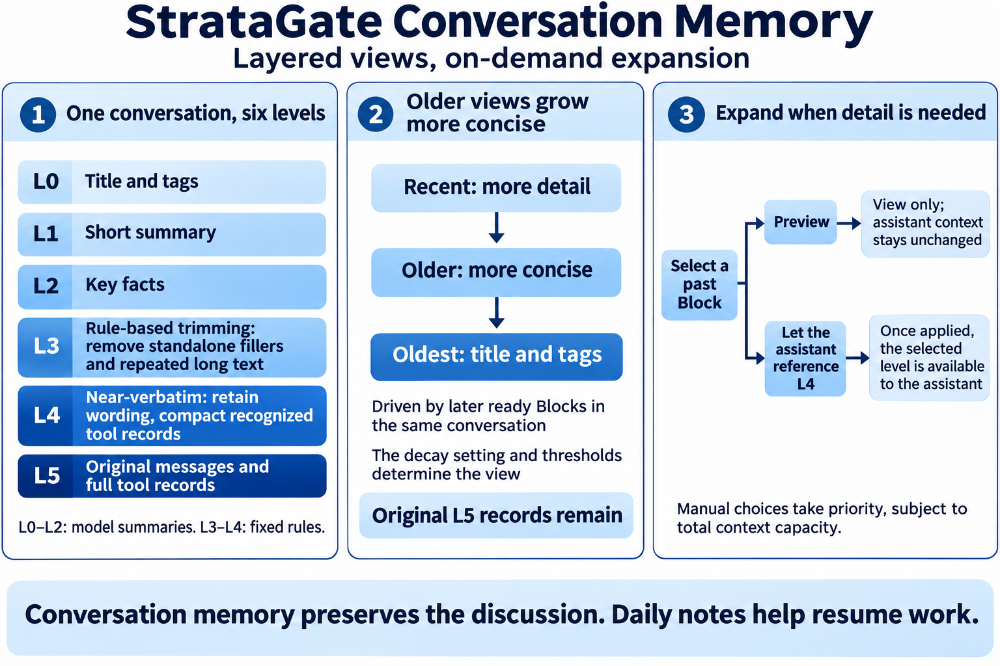
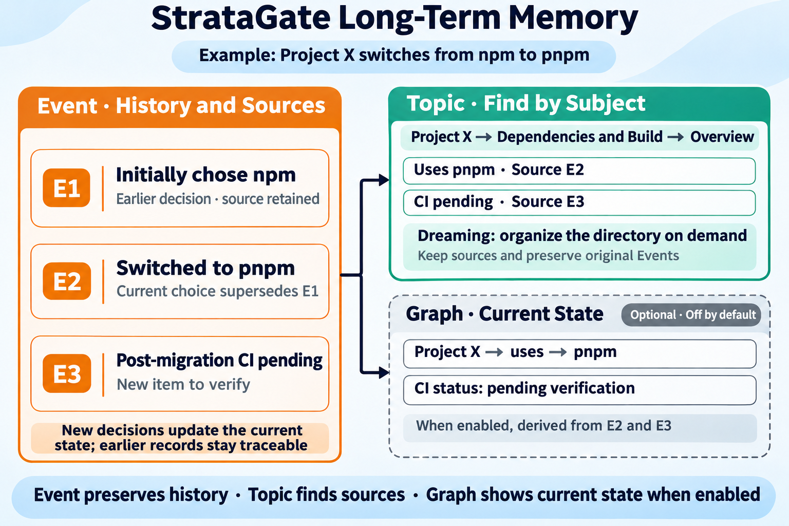

# StrataGate Memory Details, Rules & Formulas

[中文版](MEMORY_DETAILS.zh-CN.md) · [Back to README](../README.md) · [Architecture](ARCHITECTURE.md) · [DeepSeek Harness guide](DSH.md)

This document holds the detailed rules, examples, formulas, and configuration notes linked from the main [README](../README.md).

---

<a id="daily-notes"></a>

## 1. Daily notes (short-term memory)

Each memory space stores one Markdown file per day so new sessions can pick up progress, intermediate results, useful lessons from failures, blockers, and next steps.

Example project note:

```text
Project X: dependency migration

Completed: switched the project to pnpm.
Pending: verify whether CI passes after migration.
Next: run CI and check build and test results.
```

- **Default window & search:** Notes from the three most recent dates with notes are included in new sessions by default (configurable from 1 to 30). Older notes remain searchable by date or keyword.
- **Session snapshot:** Each session fixes a note snapshot when first loaded so later writes do not repeatedly churn the active context. The latest notes can still be read again on demand.
- **Verification boundary:** Daily notes are maintained by the agent and are not complete conversation transcripts. Always verify historical decisions, dates, or reasons against Events and original messages. Reading notes does not reinforce memory.
- **UI & hot-reload settings:** View notes under **DSH Settings → StrataGate-AgentMemory → Short-term memory**. Toggling daily notes, changing timezone, or adjusting the 1–30 day window takes effect immediately on save without restarting DSH; disabling stops new writes and automatic inclusion while preserving existing files.

---

<a id="conversation-memory"></a>

## 2. Conversation memory: L3/L4 pruning rules, decay formula & manual selection



### Exact L3/L4 pruning rules

The model produces L0–L2 summaries. L3 and L4 do not use model paraphrasing; code generates them with deterministic rules:

- **L4:** Remove system messages. User and assistant text is preserved except for trimming outer whitespace and adding `User`, `Assistant`, or other role labels. Recognized structured tool records retain the tool name and a result summary of at most 160 characters while omitting raw `arguments`, `params`, `input`, and `request` fields. Tool-role text that is not recognized as tool JSON remains unchanged.
- **L3:** Condense further without semantic rewriting. A sentence is removed only when, after trailing punctuation is stripped, it exactly matches a fixed filler allowlist such as `ok`, `thanks`, `got it`, `好的`, `明白`, `收到`, `谢谢`, or `可以`. After whitespace normalization and case folding, code-like paragraphs and paragraphs of at least 80 characters are deduplicated: the first copy remains verbatim, and later exact duplicates become an omission marker. Tool records use the same name-and-result-summary form as L4.
- **Length guard:** If generated L4 would be longer than L5, L5 is used instead. If L3 would be longer than L4, L4 is used instead, preserving `L3 ≤ L4 ≤ L5`.

Source records are saved first, followed by summarization and Event processing. Only a fully processed, ready Block can replace its corresponding native history and participate in decay.

### Display decay formula and default schedule

Display changes follow exponential decay:

<p align="center"><strong>w<sub>block</sub>(age) = e<sup>−λ<sub>block</sub> · age</sup></strong></p>

The default decay coefficient λ<sub>block</sub> is **0.30**. Code maps weight ranges to display levels. Smaller coefficients preserve detail for longer and therefore consume more context.

In this formula, `age` is the distance between the current display anchor and the latest ready Block in the same conversation. It measures conversation progress, **not elapsed calendar days**. Unsealed turns and Blocks still awaiting model processing do not advance this decay.

For a Block that starts at L5 and is never expanded again, the default schedule is:

| Additional ready Blocks | Default display level |
| ---: | --- |
| 0–1 | L5 |
| 2 | L4 |
| 3–4 | L3 |
| 5–6 | L2 |
| 7–8 | L1 |
| 9 or more | L0 |

Actual transitions depend on both the decay coefficient and level thresholds; each new Block does not necessarily cause a one-level drop.

### Manual level selection & capacity handling

- **Preview vs apply:** The layered-content preview is for viewing only. Choosing an action such as “Let the assistant reference L4” attempts to apply that content to the conversation. The interface distinguishes an applied choice, a pending choice, and one that cannot be applied.
- **Priority & fallback:** A user's manually chosen level takes priority over automatic compression and the agent's evidence reads. If context capacity is insufficient, the system first tries to condense other automatically managed history while preserving other manual choices; if capacity is still insufficient, it explains why.
- **Decay reset:** A manual choice resets the decay anchor, and the view can gradually become concise again as subsequent conversation accumulates. See [manual level selection details (Chinese)](user-operation-priority.md).

---

<a id="event-memory"></a>

## 3. Event memory, temporal fields & update rules



### Mention time vs occurrence time

| Time | Meaning |
| --- | --- |
| Mention time | When the conversation referred to the event |
| Occurrence time | When the event happened or is planned to happen |

If a user says “Finish the prototype next week” on May 6, May 6 is the mention date, while “next week” describes the planned completion time. This record cannot serve as evidence that the prototype is complete. Uncertain dates retain their original wording and uncertainty.

### Extraction scope

Explicit requirements, corrections, changed decisions, confirmed causes, platform limitations, failure conditions, and meaningful outcomes may be worth retaining. Routine file reads, tool calls, and repeated tests do not each become Events merely because they occurred.

Records also need an appropriate scope: for example, “Align the arrows in this image” belongs to the current task and must not automatically become a permanent aesthetic preference. See the [Event extraction guide (Chinese)](event-extractor.md) for full rules.

### Memory updates: additions, changes, conflicts & duplicates

| New information | How to interpret it |
| --- | --- |
| “The project switched from npm to pnpm” | Update the current choice while retaining the earlier decision and its sources |
| “Post-migration CI verification is pending” | Add an open question, not a claim that tests have passed |
| Two statements conflict and their validity is unresolved | Retain the conflict for further verification |
| Several records may describe the same event | Check their complete contents and sources before deciding whether to merge |

**Similarity does not establish duplication, and later progress does not make earlier records useless.** After code discovers potential duplicates, AI evaluates both records and their sources. Clearly distinct facts can remain separate; uncertain or unfinished cases are presented for user review. Users can inspect both sources, edit a merged draft, keep either record, or keep both, with processing history and undo support. Event cards also attach verbatim source quotes extracted from source messages (clearly labeled when auto-selected versus manually supplied).

---

<a id="dreaming-and-letters"></a>

## 3b. Dreaming controls & Daily Letters

- **Multiple entry points:** Start, pause, resume, or open the live Dreaming session from the **Overview**, **Topic directory**, or **More → Advanced settings**.
- **Persistent switches & daily token budget:** Under **More → Advanced settings**, you can persistently enable or disable automatic Dreaming and Daily Letters, set a **daily token budget** (default 5,000,000 tokens/day; `0` for unlimited), and inspect today's usage progress bar. Disabling automatic Dreaming or reaching the daily budget immediately halts active automatic runs across workspaces without interrupting manually triggered runs.
- **Unread source reminder:** When Dreaming creates or updates an Event referencing source messages whose full body has not yet been read, the write succeeds while returning `unreadSourceMessageIds` and a warning reminding the agent to verify facts if needed.
- **Daily Letters:** Separate from daily notes, the assistant archives at most one handwritten-style letter per workspace after a day rolls over, reflecting on concrete progress from that day's sessions. Letters open from the **Overview** page and include an expandable footer summarizing Events and reusable experiences organized by Dreaming that day (including which Events were kept after merges). Built-in per-day backoff and a 24-hour circuit breaker prevent repeated retry spend on failures.

See [Dreaming maintenance details (Chinese)](dreaming-agent.md).

---

<a id="knowledge-graph"></a>

## 4. Optional knowledge graph

The knowledge graph derives people, projects, organizations, tools, places, and relationships such as “uses,” “participates in,” and “depends on” from Events. Node attributes and relationships retain their sources. For example, “the project uses pnpm” represents the current choice, while “CI verification pending” represents an unconfirmed result; state changes only when new source evidence confirms it.

- **Off by default:** Enabling the graph adds model calls to organize entities and relationships.
- **How to enable:** Go to **More → Advanced settings → Memory configuration → Enable knowledge graph**. If historical Events need backfilling, the interface shows the pending volume for confirmation before starting.
- **Disabling safely:** Disabling the graph stops its processing, queries, and automatic recall while preserving existing graph data and sources. Event cards, topics, ordinary retrieval, and the persistent Profile work independently.

See [optional knowledge graph details (Chinese)](knowledge-graph.md).

---

<a id="persistent-profile"></a>

## 5. Persistent Profile routing & consent rules

The persistent Profile stores user information that should remain available across every session (total character limit configurable between **2,000 and 12,000 characters**, default 6,000, with the maintenance trigger scaling accordingly), separately from Events retrieved by relevance and requests that apply only to the current answer:

| User statement | Where it belongs | When it is used |
| --- | --- | --- |
| “Use Chinese by default from now on” | Persistent Profile | Automatically supplied across sessions after being set |
| “This project has switched to pnpm” | Event memory | Recalled or retrieved for relevant questions |
| “Keep this answer brief” | Current conversation | Applies to this answer |

The word “remember” alone does not determine where information belongs. Explicit user requests to change the Profile can be applied directly. Inferred Profile changes require the agent to state the proposed field and value and obtain user consent. See the [DeepSeek Harness guide](DSH.md) for fields, location selection, and character budgets.

---

<a id="evidence-gate"></a>

## 6. Retrieval enhancements & evidence gate protocol

### Retrieval methods

| Method | Purpose |
| --- | --- |
| Default retrieval | Find relevant records using keywords and related signals |
| Vector retrieval (optional) | Add semantically similar Events even when their wording differs |
| Reranking (optional) | Reorder automatic-recall candidates so more relevant memories enter context first |

Vector retrieval and reranking are configured separately and remain off when unconfigured. Reranking applies only to automatic recall and falls back to the original order on timeout or error. **A high rank, semantic similarity, or high memory weight does not establish factual accuracy or sufficient evidence for the current question.**

Empty results may reflect the selected memory scope, keywords, or filters; the agent should adjust its search rather than conclude “you never said that” from a single empty result, and should report retrieval errors explicitly.

### Evidence gate walkthrough

Example question: *“Why did we originally switch to pnpm?”*

| Step | Information found | Next action |
| --- | --- | --- |
| Locate the topic | An overview of “Project technology choices” mentions a package-manager change | Follow the sources to specific Events |
| Retrieve the Event | “The project switched from npm to pnpm” | The change is established but its reason is missing; expand the source |
| Check the original text | Example: “Installation is faster, and it better fits our multi-package structure” | Verify the project and time, then explain the reason from the source |

If the sources do not explain the reason, the agent must state that it cannot confirm it rather than infer the historical decision from pnpm's general advantages.

### Evidence assessment fields & protocol checks

| Field | What it explains |
| --- | --- |
| `verdict` | Whether evidence is sufficient, partial, or mismatched |
| `evidence_refs` | Which retrieved items support the assessment |
| `fit` | How the evidence matches the question |
| `missing` | What information is still missing |
| `next_strategy` | Whether to answer, search again, or expand a memory |

References must belong to the selected retrieval batch. Accepting `sufficient` requires valid evidence references and an explicit choice to answer. Usage records contain only evidence actually used in the answer, or an empty list when none was used. See [Architecture](ARCHITECTURE.md) and the [plugin guide](DSH.md) for interfaces.

---

<a id="weight-formula"></a>

## 7. Long-term weight formula, floors & reinforcement rules

### Criticality minimum weights

| Memory category | Default minimum weight |
| --- | ---: |
| Routine information | 0 |
| User preference | 0.3 |
| Identity information | 0.9 |
| Safety information | 1.0 |

Pinned memories have an effective weight of 1. Superseded Events normally receive a low weight cap, reducing the priority of older states. These weights manage recall priority, not factual accuracy.

### Duplicate confirmation vs duplicate-card merging

- When the active-memory tool saves information, a currently valid fact whose normalized full text matches exactly can directly reinforce an existing record. Other similar content requires further judgment (add, merge, supersede, conflict, or ignore); textual similarity alone does not reinforce.
- Duplicate-card organization can preserve both records' existing adoption history when merged, but does not count the merge operation as a new answer adoption.

### Weight formula and counters

The base Event-weight function is:

<p align="center"><strong>w(t,n) = max(floor, e<sup>−λ(n)t</sup>)</strong></p>

<p align="center"><strong>λ(n) = λ<sub>event</sub> / (1 + 1.5 ln(n))</strong></p>

The default base decay coefficient λ<sub>event</sub> is **0.015** (configurable from `0–0.2` in steps of `0.005` under **More → Engine parameters** or **More → Advanced settings**; `0` disables decay, separate from the Block decay coefficient `λ_block` in `0–0.4`).

- `t` is the difference between the current turn and the most recent reinforcement anchor (new Events start counting from creation);
- `n` is an internal count initialized to 1 and incremented by answer adoption or duplicate confirmation during active-memory recording (retrieval alone does not increment it);
- `floor` is the minimum weight assigned according to the memory's criticality.

Long-term decay uses conversation turns rather than elapsed wall-clock time. Lower weight lowers recall priority without deleting historical records.

---

<a id="configuration-and-import"></a>

## 8. Model configuration, vector/rerank & external memory import

### Memory-processing model

Under **More → Advanced settings → Host configuration → Memory-processing model**, choose to follow the chat model or specify a separate model from providers already configured in DSH. Saving applies to subsequent memory-processing requests without changing the main chat model; in-flight requests continue to completion. A model with tool-calling support and sufficient context capacity is recommended. If the specified model is unavailable, the task retains its failure state rather than silently switching to the main chat model.

### Vector retrieval & reranking

In advanced settings, enter each service's API URL, key, and model, then save. A service is enabled only when its configuration is complete; clear its URL and save to disable it. When enabled, search text and Event titles/summaries (or candidate Event content for reranking) are sent to the selected service provider and may incur API charges. Neither service replaces Event sources or the evidence gate.

### Upgrades & local storage

Restart the corresponding DSH profile after upgrading. The current version covers DSH **0.2.x** (including prereleases) and retains previously supported older hosts; DSH **0.3.x** is not yet supported. Conversation sources and long-term memories are stored in local SQLite, while daily notes are separate Markdown files; uninstalling the plugin does not automatically delete this data. See the [DeepSeek Harness guide](DSH.md) for the complete version range, repairs, and recovery.

### External AI memory import

In the DSH UI, pasted memory summaries are previewed before committing: exact duplicates can be ignored, changes can add/merge/supersede existing facts, and unresolved differences can be flagged as conflicts. Low-confidence decisions allow manual selection, committed batches can be undone, and original imported text plus earlier Events remain preserved. See the [external-memory import guide (Chinese)](EXTERNAL_MEMORY_IMPORT.zh-CN.md).

---

<a id="evaluation-failure-analysis"></a>

## 9. R8 evaluation failure breakdown (`conv-26`)

In the published R8 comparison on `conv-26`, **31 of 152 questions were judged incorrect by a majority of evaluators**. Grouped by the observable failure stage:

| Failure stage | Questions | What it indicates |
| --- | ---: | --- |
| Incorrect direct answer without retrieval | 15 | The agent sometimes failed to recognize that historical evidence was needed |
| Evidence judged sufficient, but the final answer was incorrect | 14 | Evidence could concern a neighboring event or fail to support the complete answer |
| Evidence remained insufficient at the retrieval budget | 2 | Enough information was not found within the allotted budget |

Within this evaluation, the results point to improving when retrieval starts and whether retrieved evidence truly answers the question. The evidence gate constrains references and assessment procedures, but cannot guarantee the model's semantic judgment or final answer. See the [full evaluation](EVALUATION.md) for R1–R8 history and per-question analysis.
