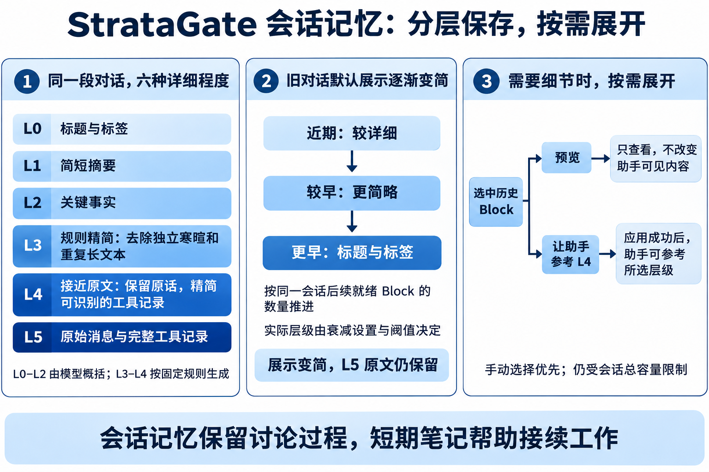
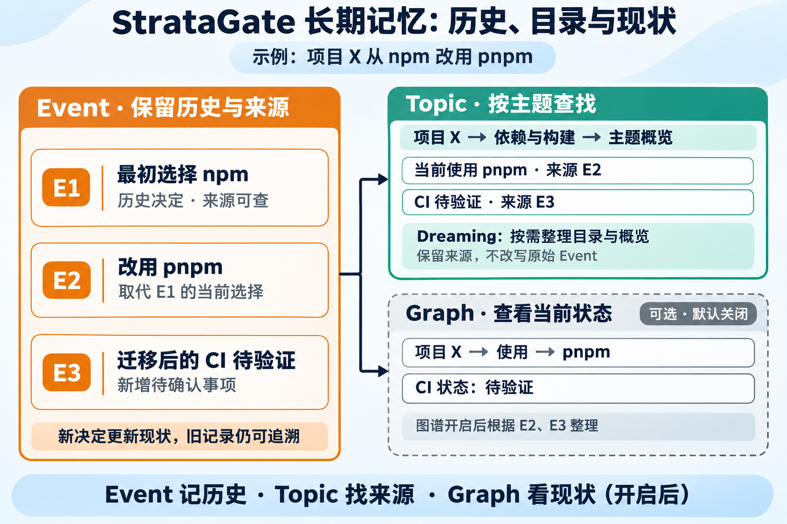

# StrataGate 记忆机制细则、公式与配置说明

[English](MEMORY_DETAILS.md) · [返回 README](../README.zh-CN.md) · [架构文档](ARCHITECTURE.md) · [DeepSeek Harness 使用说明](DSH.zh-CN.md)

本文档承接主 [README](../README.zh-CN.md) 中外链出来的具体规则、示例、数学公式与配置细节。

---

<a id="daily-notes"></a>

## 1. 每日笔记（短期记忆）

每个记忆空间每天保存一份 Markdown 文件，帮助新会话快速了解进展、阶段结果、有效失败经验、阻塞和下一步。

项目笔记示例：

```text
项目 X：依赖迁移

已完成：项目改用 pnpm。
待确认：迁移后的 CI 是否通过。
下一步：运行 CI，检查构建与测试结果。
```

- **默认窗口与搜索：** 新会话默认带入最近三个有笔记日期的内容（可在设置中调整为 1–30）；更早的笔记仍可按日期或关键词查找。
- **会话快照：** 每个会话首次加载时固定一份笔记快照，后续写入不会反复改变当前上下文，需要时可重新读取最新内容。
- **核实边界：** 每日笔记由 Agent 维护，不是完整对话记录；核实决定、时间或原因时，应继续检索事件和原始消息。读取笔记不会触发记忆强化。
- **查看与热更新开关：** 可在 **DSH 设置 → StrataGate-AgentMemory → 短期记忆** 中查看。开关、时区与 1–30 天带入窗口保存后立即生效，无需重启；关闭每日笔记后停止写入和自动带入，已有文件保留。

---

<a id="conversation-memory"></a>

## 2. 会话记忆：L3/L4 精简规则、衰减公式与手动选择



### L3/L4 固定精简规则

L0–L2 由模型概括生成；L3、L4 不调用模型改写，由程序按固定规则生成：

- **L4：** 删除 system 消息；用户和助手正文只裁剪首尾空白并添加 `User`、`Assistant` 等角色标签。对于能够识别的结构化工具记录，只保留工具名称和最长 160 字符的结果摘要，省略原始 `arguments`、`params`、`input` 和 `request`；无法识别为工具 JSON 的 tool 正文保持原样。
- **L3：** 在不改写语义的前提下进一步精简。只有当整句去掉末尾标点后命中固定白名单时，才删除 `ok`、`thanks`、`好的`、`明白`、`收到`、`谢谢`、`可以` 等独立寒暄或确认。程序把连续空白合并并忽略大小写后，对代码型段落或至少 80 字符的长段落去重：第一次保留原文，之后的完全重复内容替换为省略标记。工具记录采用与 L4 相同的名称和结果摘要形式。
- **长度保护：** 如果生成的 L4 比 L5 更长，就直接使用 L5；如果 L3 比 L4 更长，就直接使用 L4，确保 `L3 ≤ L4 ≤ L5`。

原始记录先保存，摘要和事件处理随后进行。只有处理完成、进入就绪状态的 Block，才会替换对应的原生历史并参与衰减。

### 展示衰减公式与默认层级表

Block 的展示变化由指数衰减控制：

<p align="center"><strong>w<sub>block</sub>(age) = e<sup>−λ<sub>block</sub> · age</sup></strong></p>

其中，衰减系数 λ<sub>block</sub> 默认取 **0.30**，程序根据权重区间选择当前展示层级。系数越小，详细内容保留得越久，相应占用的上下文也越多。

公式中的 `age` 按当前展示锚点与同一会话最新就绪 Block 之间的距离计算。它衡量的是对话积累的进度，**不是现实中经过的天数**。尚未封存的对话，以及仍在等待模型处理的 Block，都不会推动这项衰减。

一个从 L5 开始、期间没有重新展开的 Block，在默认参数下会经历：

| 后续新增的就绪 Block 数量 | 默认展示层 |
| ---: | --- |
| 0–1 | L5 |
| 2 | L4 |
| 3–4 | L3 |
| 5–6 | L2 |
| 7–8 | L1 |
| 9 及以上 | L0 |

实际层级变化由衰减参数和层级阈值共同决定，并非每新增一个 Block 就下降一级。

### 手动层级选择与容量回退

- **预览与应用分离：** 界面中的“分层内容预览”只用于查看；点击“让助手参考 L4”等按钮后，才会尝试把所选内容应用到会话，并区分已生效、等待生效与无法应用状态。
- **优先级与容量不足：** 用户手动选择的层级优先于自动压缩和 Agent 的证据读取。上下文放不下时，系统会先尝试简化其他自动管理的历史，保留其他手动选择；仍然不足时说明原因。
- **衰减起点重置：** 手动选择会重设衰减起点，随着后续对话积累，仍可继续逐渐变简。详情见[手动层级选择说明](user-operation-priority.md)。

---

<a id="event-memory"></a>

## 3. 事件记忆、时间字段与更新规则



### 提及时间与发生时间

| 时间 | 表示什么 |
| --- | --- |
| 提及时间 | 这件事什么时候在对话中被说到 |
| 发生时间 | 事情实际发生或计划发生的时间 |

例如，用户在 5 月 6 日说“下周完成原型”，5 月 6 日是提及时间，“下周”描述计划完成时间。这条记录不能当作“原型已经完成”的证据；无法确定的时间保留原始表达和不确定性。

### 提取范围与边界

用户的明确要求、纠正和改变决定，以及已确认的根因、平台限制、失败条件和重要结果，都可能值得保留；普通读文件、运行工具和重复测试不会仅因发生过就各自生成事件。记录也区分适用范围，例如“这张图的箭头要对齐”属于当前任务，不会自动扩大成永久审美偏好。具体规则见[事件提取说明](event-extractor.md)。

### 记忆更新：补充、变化、冲突与重复

| 新信息 | 如何理解 |
| --- | --- |
| “项目从 npm 改用 pnpm” | 更新当前选择，保留原来的决定及其来源 |
| “迁移后的 CI 待验证” | 补充待确认事项，不代表测试已经通过 |
| 两种说法矛盾，无法确定哪条有效 | 保留冲突，等待进一步核实 |
| 多条记录可能描述同一件事 | 检查完整内容与来源，再决定是否合并 |

**相似不等于重复，后续进展也不等于旧记录无用。** 程序发现重复候选后，由 AI 结合双方内容和来源判断；明确不同的事实可以同时保留，不确定或未完成的候选交给用户复核。用户可查看双方来源、编辑合并稿、保留其中一条或同时保留，并保留处理历史与撤销入口。事件卡还会从来源消息中按相似度自动抽取逐字原文引用，并标明属于自动抽取还是人工引用。

---

<a id="dreaming-and-letters"></a>

## 3b. Dreaming 控制、预算与每日来信

- **多入口管理：** 可直接从**总览页**、**主题目录页**或**更多 → 高级设置**启动、暂停、继续或打开对应的 Dreaming 整理会话。
- **永久开关与每日 Token 上限：** 在**更多 → 高级设置**中提供自动 Dreaming 永久开关、每日来信开关与**每日 Token 上限**（默认 500 万/天，`0` 表示不限），并展示今日真实消耗进度条。任一工作区关闭自动开关或达到预算上限时，会立即中止各工作区正在运行的自动任务，但不会误杀手动启动或继续的任务。
- **未读原文提醒：** 当 Dreaming 写入或更新 Event 引入了尚未完整读过正文的原始消息来源时，照常保存并返回 `unreadSourceMessageIds` 与提醒，提示按需核对原文并在有出入时修正。
- **每日来信（Daily Letters）：** 独立于每日笔记，助手在跨日后按工作区归档手写风格来信（每天最多一封），回顾当天会话推进的事情；可从**总览页**打开翻阅，末尾可展开查看当天整理涉及的事件、经验以及合并后保留的事件。内置单日退避与 24 小时连续失败熔断，避免异常空转扣费。

详情见[Dreaming 记忆整理说明](dreaming-agent.md)。

---

<a id="knowledge-graph"></a>

## 4. 可选知识图谱

知识图谱根据 Event 整理人物、项目、组织、工具和地点，以及“使用”“参与”“依赖”等关系，节点属性与关系均保留来源。例如，“项目使用 pnpm”表示当前选择，“CI 待验证”表示尚未确认的结果；只有新的来源证据确认后，才更新状态。

- **默认关闭：** 开启图谱会额外调用模型整理实体和关系。
- **开启入口：** **更多 → 高级设置 → 记忆配置 → 启用知识图谱**；存在待补建的历史事件时，会先显示处理数量，确认后再开始。
- **安全关闭：** 关闭图谱后停止相关处理、查询和自动召回，已有图谱数据及来源保留；事件卡、主题目录、普通检索和常驻画像独立工作。

详情见[可选知识图谱说明](knowledge-graph.md)。

---

<a id="persistent-profile"></a>

## 5. 常驻画像的保存位置与同意规则

常驻画像保存需要持续参考的用户信息（总字数上限可在 **2,000–12,000 字**间自定义，默认 6,000，维保触发线随上限联动），与按相关性查找的事件、仅本次有效的要求分开：

| 用户表达 | 保存位置 | 什么时候使用 |
| --- | --- | --- |
| “以后默认用中文回答” | 常驻画像 Profile | 设置后跨会话自动提供 |
| “这个项目已经改用 pnpm” | 长期事件 Event | 在相关问题中召回或检索 |
| “这次回答简短一点” | 当前对话 | 用于本次回答 |

“记住”一词本身不决定保存位置。用户明确要求修改画像时可以直接应用；由 Agent 推断的画像变化，需要先说明拟修改的字段与内容，并取得用户同意。字段列表、地点选择与字数预算见[插件使用说明](DSH.zh-CN.md)。

---

<a id="evidence-gate"></a>

## 6. 检索增强与证据门流程

### 检索方式

| 方式 | 作用 |
| --- | --- |
| 默认检索 | 根据关键词等信息查找相关记录 |
| 向量检索（可选） | 补充说法不同、意思接近的事件 |
| 结果精排（可选） | 重新排列自动召回的候选，让更相关的记忆优先进入上下文 |

向量检索与精排分别配置，未配置时不启用。精排只作用于自动召回，超时或出错时回退原顺序。**排序靠前、语义相似或权重较高，都不代表内容一定正确，也不代表足以回答当前问题。**

空结果可能与当前记忆范围、关键词或筛选条件有关，Agent 应调整查找方式，不能仅凭一次空结果断言“你没有说过”；检索发生错误时也应明确说明。

### 证据门核对示例

以提问“为什么当初改用了 pnpm”为例：

| 步骤 | 找到的内容 | 应如何处理 |
| --- | --- | --- |
| 找到主题 | “项目技术选型”的概览提到换了包管理器 | 沿来源查找具体事件 |
| 检索事件 | “项目已从 npm 改为 pnpm” | 只能确认变更，原因仍缺失，继续展开 |
| 核对原文 | 示例原话：“安装更快，也更适合我们的多包结构” | 核对项目和时间后，按来源解释原因 |

若来源没有说明原因，Agent 应明确表示无法确认，不能根据 pnpm 的一般优点推测当时的决定。

### 证据评估字段与流程检查

| 评估项 | 需要说明的内容 |
| --- | --- |
| `verdict` | 证据充分、部分充分，还是与问题不符 |
| `evidence_refs` | 哪些检索结果支持当前判断 |
| `fit` | 证据与问题具体匹配在哪里 |
| `missing` | 还缺少哪些信息 |
| `next_strategy` | 直接回答，还是继续搜索或展开 |

引用必须来自指定检索批次；接受 `sufficient` 时需要有效证据引用，并明确选择回答。采用记录只包含实际用于答案的证据，没有采用则提交空列表。接口详情见[架构文档](ARCHITECTURE.md)与[插件使用说明](DSH.zh-CN.md)。

---

<a id="weight-formula"></a>

## 7. 长期权重公式、最低权重与强化规则

### 不同记忆类别的最低权重

| 记忆类别 | 默认最低权重 |
| --- | ---: |
| 普通信息 | 0 |
| 用户偏好 | 0.3 |
| 身份信息 | 0.9 |
| 安全信息 | 1.0 |

置顶记忆的有效权重保持为 1；被取代的事件通常设置较低的权重上限，减少旧状态继续优先出现的机会。这些权重用于管理召回优先级，而非事实正确率。

### 主动写入重复确认与重复卡合并

- 使用主动记忆工具保存信息时，规范化后全文一致的当前有效事实，可以直接强化已有记录；其他相似内容需要进一步判断（新增、合并、取代、标记冲突或忽略），不能仅凭文字相似直接强化。
- 重复卡合并可以保留双方已有的采用信息，但不会把整理操作计为一次新的回答采用。

### 权重公式与计数含义

长期 Event 的基础权重函数为：

<p align="center"><strong>w(t,n) = max(floor, e<sup>−λ(n)t</sup>)</strong></p>

<p align="center"><strong>λ(n) = λ<sub>event</sub> / (1 + 1.5 ln(n))</strong></p>

默认基础衰减系数 λ<sub>event</sub> 为 **0.015**（可在**更多 → 引擎参数**或**高级设置**中按 `0.005` 步进在 `0–0.2` 范围内调整，`0` 表示关闭衰减；与 `0–0.4` 范围的 Block 衰减系数分开配置）。

- `t` 是当前轮次与最近一次强化锚点的差，新事件从创建时开始计算；
- `n` 是内部计数，初始化为 1，答案采用或主动记忆重复确认时增加，单纯检索不增加；
- `floor` 是根据记忆重要程度设置的最低权重。

长期权重衰减同样按对话轮次计算，而不是按现实时间计算；较低的权重会降低召回优先级，但不会删除历史记录。

---

<a id="configuration-and-import"></a>

## 8. 模型配置、向量/精排与外部 AI 记忆迁移

### 记忆处理模型

在 **更多 → 高级设置 → 宿主配置 → 记忆处理模型** 中，可选择“跟随聊天模型”或“单独指定模型”（使用 DSH 已配置的服务商与模型），保存后作用于后续记忆处理，聊天主模型保持不变，已运行的请求继续完成。建议选择支持工具调用、上下文容量足够的模型；指定模型不可用时任务会保留失败状态，不会自动改用聊天主模型。

### 向量检索与精排

在高级设置中分别填写对应服务的 API 地址、密钥和模型并保存；配置完整后启用，清空地址并保存即可停用。启用后，检索文本与事件标题、摘要（精排为候选事件内容）会发送到所选服务商，可能产生 API 费用。两者均不替代事件来源或证据门判断。

### 升级与本地存储

升级后请重启对应的 DSH profile。当前版本覆盖 DSH **0.2.x** 及其预发布版并保留旧版适配，DSH **0.3.x** 暂不支持。会话来源和长期记忆保存在本地 SQLite，每日笔记单独保存为 Markdown，卸载插件不会自动删除这些数据。完整版本范围与恢复方式见[插件使用说明](DSH.zh-CN.md)。

### 外部 AI 记忆迁移

DSH 管理界面支持导入预览：重复内容可忽略，变化可新增、合并或取代旧状态，不确定关系可标为冲突；低置信度项支持人工选择，提交后支持按批次撤销，原始导入内容和旧事件及其来源均会保留。导出格式与示例见[外部记忆导入说明](EXTERNAL_MEMORY_IMPORT.zh-CN.md)。

---

<a id="evaluation-failure-analysis"></a>

## 9. R8 评测失败阶段分析（`conv-26`）

在公开的 `conv-26` R8 评测中，有 **31 / 152 道题被多数评审判为错误**，按可观察到的失败阶段划分：

| 失败阶段 | 题数 | 反映的问题 |
| --- | ---: | --- |
| 未发起检索，直接回答错误 | 15 | Agent 有时未意识到需要查找历史证据 |
| 证据被判为充分，最终答案仍然错误 | 14 | 证据可能属于相邻事件，或不足以支持完整答案 |
| 达到检索预算时，证据仍不充分 | 2 | 在给定预算内没有找到足够的信息 |

结果表明在该评测范围内，仍需改进何时发起检索以及如何判断证据是否真正回答了问题。证据门约束引用与评估流程，但不能保证模型的语义判断或最终答案一定正确。R1–R8 演变与逐题分析见[完整评测](EVALUATION.md)。
